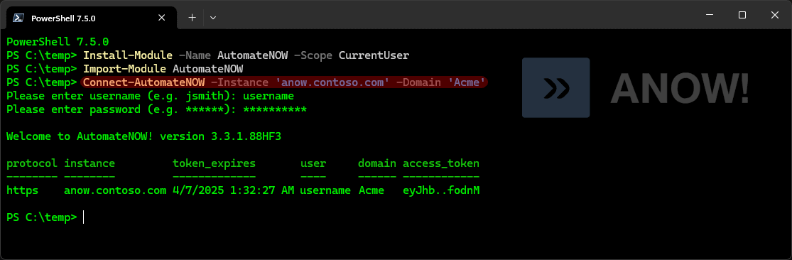
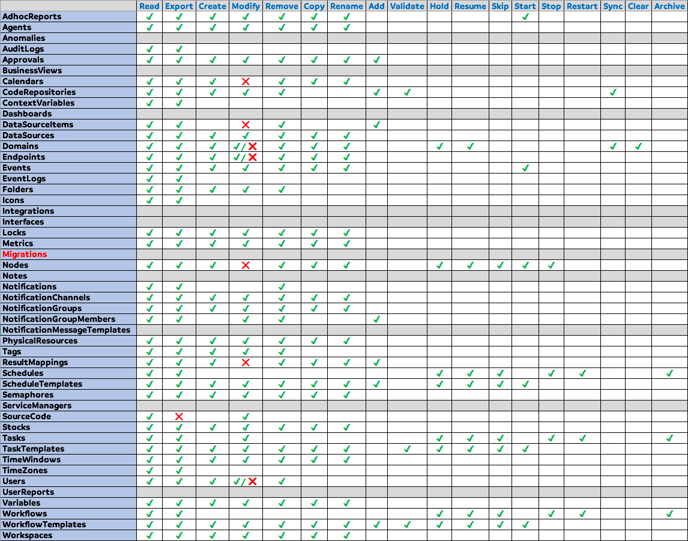

# AutomateNOW! PowerShell module

> Requires an account on an AutomateNOW! instance



```
Created by AutomateNOW-Fan
```
```
⚠ Not affiliated with Beta Systems
```
## Efficacy 🧪

Compatible with AutomateNOW! version _3.3.1.100_
<br/><br/>
## Installation 🏗

Install from the PowerShell Gallery 👉 `Install-Module -Name AutomateNOW -Scope CurrentUser`
<br/><br/>
## Usage 🤔
Use `Connect-AutomateNOW` to establish your session
<br/><br/>
## Features 🤓

- Completely browserless operation
- Both http & https protocols supported
- PowerShell Core (incl. Linux 🐧) & Windows PowerShell compatible
- Classes and enums are defined (see Classes.psm1)
- Pipeline capability to streamline your workloads
- Session tokens will be automatically refreshed during usage
- All functions can return help with Get-Help or the -? parameter
- PSScriptAnalyzer compliant / Approved verbs only
- Rated A+ for code quality by Copilot 🤖 (requires `copilot-instructions.md`)
- Alternate encryption key bytes can be supplied (let's hope it is never needed 🤞)
- Integration with the git app for showing out of sync item that require manual merging
- Edit source code objects with NotePad (Windows only for now)
<br/><br/>
## Change Log 📝

## 1.0.46

### Major updates

- New Functions: `Invoke-AutomateNOWCodeRepositoryItemCommit`, `Invoke-AutomateNOWCodeRepositoryItemRollback`

- Fixed the Code Repository Git merge-conflict workflow. File-based conflicts
  are now listed, compared, and resolved through the correct
  `codeRepositoryConflict` API contract.
- `Get-AutomateNOWCodeRepositoryConflictItem` now returns the correct typed
  conflict records for Git files. The conflict model now retains the file,
  file path, simple ID, and domain class information needed by follow-on
  commands.
- `Compare-AutomateNOWCodeRepositoryConflictItem` and
  `Merge-AutomateNOWCodeRepositoryConflictItem` now distinguish ANOW-local
  content (`yours`) from remote Git branch content (`theirs`) correctly.

### Minor updates

- Removed credential-bearing and token-bearing values from authentication and
  request diagnostics. Passwords, access and refresh tokens, Authorization
  header values, clipboard authentication JSON, request bodies, and raw
  authentication responses are no longer written to verbose, debug, warning,
  or error output. Request diagnostics now contain safe metadata such as the
  method, URI, content type, header names, body presence/length, and whether a
  proxy was used.
- Added shared opaque-token validation for connection, confirmation, refresh
  prerequisites, and the API wrapper. Empty, whitespace-containing, malformed,
  or inconsistent token/header state is rejected without echoing the rejected
  value.
- Direct-credential authentication now constrains `-Key` to exactly 16 bytes
  and passes the selected key consistently through password protection and the
  authentication request helper.
- Secure-string conversion now uses a BSTR in both Windows PowerShell and
  PowerShell 7. BSTR allocation, conversion, and cleanup pass through small
  private boundaries, and `ZeroFreeBSTR` runs from `finally` after both success
  and failure so unmanaged plaintext is not left allocated.
- Authentication responses are parsed as JSON rather than matched as strings.
  Token type, lifetime, expiration, access token, and refresh token fields are
  validated independently, and malformed or partial responses fail with
  sanitized messages.
- `Connect-AutomateNOW -ReadJSONFromClipboard` now requires a usable access
  token and safely validates numeric fields with `Int64.TryParse` on both
  supported PowerShell editions. Invalid clipboard input returns without
  falling through to an interactive username/password prompt.

- Connection setup now builds a local candidate session and publishes
  `$global:anow_session` only after authentication, instance discovery, domain
  selection, timezone resolution, and user hydration all succeed. A failed
  replacement leaves the existing global session object untouched.
- Authentication and discovery locals—including user id, default domain,
  server timezone, and token-response state—are initialized explicitly and no
  longer inherit stale values from the caller or an earlier attempt.
- Instance metadata is extracted from the AutomateNOW home page with a
  quote-aware, balanced-object parser. The parser tolerates property-order,
  indentation, line-ending, nested-object, and braces-inside-string differences
  instead of depending on one exact JavaScript line format.
- Required instance discovery remains mandatory. `-SkipMOTD` suppresses only
  the welcome message and is no longer suggested as a remedy for home-page or
  instance-metadata failures.
- Non-quiet connection success returns an unformatted, safe `PSCustomObject`
  containing connection facts rather than token fragments or formatting
  objects. `-Quiet -SkipMOTD` produces no connection success object.
- License-status warnings now include the entire documented zero-through-30-day
  range, including zero days. Negative values retain the prior sentinel policy
  until the vendor contract distinguishes perpetual and expired negative
  values.
- Proxy validation now requires a clean absolute HTTP or HTTPS URI with a host
  and an explicit port from 1 through 65535. Credentials, outer whitespace,
  paths, queries, and fragments are rejected; valid IPv4 and bracketed IPv6
  proxy forms are passed to the request layer without changing certificate
  policy.

- PowerShell 7 now retains normal HTTPS certificate validation unless
  `-SkipCertificateCheck` is explicitly supplied. Proxy use no longer implies a
  certificate bypass.
- In Windows PowerShell 5.1, the temporary certificate callback is installed
  only for an explicit bypass and is always restored in `finally`, including
  when the web request throws. A request cannot leave the process-wide callback
  altered after it completes.
- The chosen certificate policy is retained in the completed session so
  authentication, instance discovery, token refresh, and later API calls use
  one consistent transport policy.

- `-Domain` remains optional during Connect bootstrap so the logged-on user's
  available and default domains can be discovered. After selection, however,
  the session is not considered domain-ready until both canonical domain fields
  contain the same exact-case value.
- Domain names are treated as case-sensitive throughout connection and domain
  switching. Available-domain membership and default-domain selection use exact
  case rather than PowerShell's default case-insensitive collection operators.
- An explicitly requested domain is now checked against the logged-on user's
  exact-case domain membership before it is placed in `header.domain` or used
  for server timezone discovery. Wrong-case and unavailable domains therefore
  fail transactionally with useful domain guidance instead of first failing a
  request under a provisional header.
- Once a domain is selected, `current_domain` and `header.domain` are updated
  together and must remain exactly equal. The incorrect legacy header key used
  by earlier switching logic is no longer written.
- Connection bootstrap first uses the local timezone catalogue while domain
  membership is unknown, then replaces it with the authoritative server
  catalogue after domain validation. Server and user timezones are resolved
  from the selected catalogue on every connection path rather than being
  inherited from ambient state.
- `Switch-AutomateNOWDomain` now requires a non-empty `-Domain` during parameter
  binding, performs only local exact-case validation, and cannot refresh a token
  or contact the server as a side effect. Successful switching updates both
  canonical domain fields atomically.

- Unix expiration conversion now uses `DateTimeOffset`. Connection timestamps
  use the documented millisecond form, while refresh compatibility accepts the
  vendor's observed seconds-or-milliseconds values.
- Tokens with one through 60 seconds remaining are treated as still valid.
  Failed connection replacement or refresh no longer destroys an existing
  session merely because it is near expiration.
- Refresh responses are fully staged and validated before any session field is
  committed. Null, malformed, partial, non-advancing, unexpected-token-type, or
  failed refresh responses preserve the prior access token, refresh token,
  Authorization header, and expiration.
- Refresh request fields are encoded through `ConvertTo-QueryString`, so
  reserved characters in a refresh token are preserved correctly in the form
  body.
- `Confirm-AutomateNOWSession` catches refresh failures and returns `True` only
  after the session is structurally valid and, when refresh was required, the
  new expiration is future-dated and strictly later than the previous value. A
  successful confirmation emits exactly one Boolean.
- Shared session validation now checks the instance, access-token and
  Authorization-header identity, refresh-token state, expiration shape and
  policy, and canonical domain consistency appropriate to each operation.
- `MaximumTokenRefreshAge` is documented and implemented as a remaining token
  lifetime threshold, defaults to 3300 seconds, and rejects negative values.
- `Update-AutomateNOWToken` retains its historical no-success-output contract,
  supports `WhatIf`, and uses sanitized terminating errors for refresh failure.
- `-Quiet` suppresses successful refresh information and verbose confirmation
  while preserving warnings for an invalid session. Help now describes this
  behavior accurately.
- Future sessions created with `-DoNotRefresh` remain valid for bounded work;
  expired or malformed expirations fail. The Unix epoch remains the explicit
  unknown-expiration sentinel for compatibility and produces a warning rather
  than being silently treated as a normal future token.

- Ordinary failure exits in Connect, Disconnect, Update, Confirm, Switch, and
  JWT issuer reset now return to the caller or raise a deliberate sanitized
  terminating error instead of using `Break` to terminate caller-owned scripts,
  loops, or switch statements.
- `Disconnect-AutomateNOW` attempts the server logout notification whenever the
  session contains the minimum request fields, even when expiration is unknown,
  and then completes the requested local session disposition.
- `-KeepSessionVariable` is honored consistently on valid, invalid, expired,
  partial, and server-notification-failure paths. Status information accurately
  reports whether the global session was retained or removed.

- `Reset-AutomateNOWJWTIssuerToken` now always routes the destructive operation
  through `ShouldProcess`. `-Force` suppresses the confirmation prompt but never
  bypasses `-WhatIf`; `-Force -WhatIf` sends no API request.
- Invalid-session, request-failure, missing-response, malformed-status, and
  nonzero-response paths return normally with sanitized diagnostics. Caller
  control flow is no longer terminated by `Break`, and response data is not
  embedded in warning or error messages.
- The command no longer converts or returns the complete application
  configuration, which can contain OAuth secrets, certificate passwords,
  messaging credentials, passphrases, and license data. Normal success returns
  only a minimal acknowledgement containing the instance, reset status, and the
  fact that API-user tokens were revoked; `-Quiet` suppresses that object.
- Help now clarifies the blast radius: resetting the JWT issuer invalidates API
  user tokens, not ordinary logged-in user sessions. No live reset is required
  to validate the command's PowerShell safety contract.

- `New-AutomateNOWCodeRepository` now returns the newly created typed
  `[ANOWCodeRepository]` object after successful creation.

- Improved Security Role safety and reliability:
  - `New-AutomateNOWSecurityRole` now supports `-WhatIf` and `-Confirm`.
  - `Set-AutomateNOWSecurityRoleDomain` now requires explicit
    `-AllowAdminDowngrade` acknowledgement before a granular update can remove
    Domain Admin access. `-Force` does not bypass this safeguard.
  - `Copy-AutomateNOWSecurityRoleDomain` now preserves Boolean permissions and
    tag-scoped permissions while omitting server-managed metadata.
  - `Add-AutomateNOWSecurityRoleUser` and
    `Remove-AutomateNOWSecurityRoleUser` now page through role assignments in
    10,000-record batches before making membership decisions.
  - `Set-AutomateNOWSecurityRole` now rejects contradictory `-LDAPMapping` and
    `-UnsetLDAPMapping` input.
  - `Set-AutomateNOWSecurityRoleDomain -AllowDesignCoreModificationTags` now
    writes the supported `designModifyTags` permission field rather than the
    non-persisting legacy field used by earlier module versions.
  - `Set-AutomateNOWSecurityRoleDomain -AllowDesignCoreModifyTags` blocks
    every explicitly bound value, including empty and null input, for the
    unsupported legacy field before an API request.
  - `designVerification` is now included in the normal Security User
    permission catalogue and effective-permission reports. `designCoreModify`
    and `taskLog` remain available only as hidden compatibility properties
    when `-IncludeUndocumented` is explicitly requested.
  - The module does not expose browser-only Design Action, Workflow Items,
    Notification, or Design Resource companion fields as public permissions.
    The Design Action and Workflow Items tag candidates did not persist on
    exact read-back; the remaining browser-only candidates are unsupported by
    product policy.
  - Domain-role reads and mutations when `-Quiet` is not used now return a safe
    typed result when ANOW supplies nested role data, a null creation date, or
    unsupported raw response fields.
  - `Read-AutomateNOWSecurityRoleDomain -Id` now has a direct-id parameter
    set that does not require a parent Security Role.
  - `Read-AutomateNOWSecurityRoleUser` removed obsolete `-ItemId` and
    now hydrates an exact assignment's role from the returned role id.
  - `New-AutomateNOWSecurityRole` treats an absent exact-id preflight as a
    normal create condition even when warning preference is `Stop`.
  - Corrected public simple-ID validation to use `A-Z` rather than the
    unintended `A-z` ASCII range. IDs containing punctuation that previously
    fell between uppercase and lowercase letters are now rejected.
- Repaired Security User permission reporting:
  `Measure-AutomateNOWSecUserPermission` now calculates per-domain effective
  access (`Denied`, `Unrestricted`, or `TagRestricted`) across Security Role
  Domain grants; supported `*Tags` selections are provenance rather than
  standalone grants. `Compare-AutomateNOWSecUserPermission` retains Boolean
  `-Basic` and adds tag-aware `-EffectiveScope`; its equality filters include
  permissions denied to both users. `Resolve-AutomateNOWSecUserPermission`
  accepts direct and pipeline input without cross-domain tag inference, and
  `Export-AutomateNOWSecUserPermission` preserves effective-scope and
  role-provenance columns. Measure and Compare explicitly reject
  instance-admin accounts because instance-wide access is not modeled.
  A selected `-PermissionList` with no effective grant now emits an empty
  success stream rather than a null record, avoiding downstream pipeline
  binding failures present in earlier module versions.
- Added optional, case-sensitive `-ConflictResolutionType 'yours'|'theirs'`
  parameters to `Receive-AutomateNOWCodeRepository` and
  `Sync-AutomateNOWCodeRepository`. The choice applies only when the initial
  Pull or Synchronize operation encounters a merge conflict; it does not
  resolve a conflict already persisted by an earlier operation.
- Corrected the `ANOWCodeRepositoryOutOfSyncItem` response model so
  `Get-AutomateNOWCodeRepositoryOutOfSyncItem` can parse the object-oriented
  identity, provenance, timestamp, and conflict metadata returned by the
  `/outOfSyncObject/read` endpoint.
- `Resolve-AutomateNOWCodeRepository` now sends the repository simple ID to
  the vendor resolve-conflicts operation and correctly processes each
  repository in a multi-item pipeline.
- Added `Connect-AutomateNOW -DoNotRefresh` for bounded work with a verified,
  non-expired token when automatic refresh is unavailable. Automatic refresh
  remains the default and is recommended for normal or long-running work.
- Repaired `Sync-AutomateNOWCodeRepository` for direct `-CodeRepository`
  invocation and multi-repository pipeline input; successful `-Quiet` calls
  remain silent apart from verbose confirmation.
- Corrected `Set-AutomateNOWVariable -Value` to include the target variable's
  required domain in the value-update request.
- `Get-AutomateNOWTimeZone -Id` now accepts time-zone identifiers containing
  underscores.
- Clarified `Publish-AutomateNOWCodeRepository`: default Publish commits
  changed items, `-ForceCommit` commits all items, and `-Force` only bypasses
  the PowerShell confirmation prompt.
- Tightened Code Repository command contracts: `Confirm-AutomateNOWCodeRepository`
  now requires a repository object; `Approve-AutomateNOWCodeRepositoryMergeRequest`
  and `Deny-AutomateNOWCodeRepositoryMergeRequest` now require an explicit
  merge-request object; named branch and merge-request lookups can select a
  requested page; and `Get-AutomateNOWCodeRepository -Id` cannot be combined
  with list filters that the endpoint would ignore.
- `Export-AutomateNOWCodeRepositoryObjectSource` now writes a tab-delimited
  `.tsv` file and preserves the supplied source object while escaping control
  characters in exported content.
- `Get-AutomateNOWCodeRepositoryObjectSource -RuntimeAction` now sends the
  Runtime Action simple ID required by the vendor source endpoint, restoring
  typed source retrieval for Runtime Actions.

## 1.0.45
### Major updates
- Bump compatibility to ANOW version _3.3.1.100_

### Minor updates
- Clarified the warning emitted by `Get-AutomateNOWAgentSysOutLog` when the task has an empty `logFileName`

## 1.0.44
### Major updates
- Bump compatibility to ANOW version _3.3.1.99 HF3_
- Documention Items are added and fully supported 📚
- `Trace-AutomateNOWProcessing` is working correctly again (again!)

### Minor updates
- Added new functions: `Add-AutomateNOWDocumentation`, `Export-AutomateNOWDocumentation`, `Read-AutomateNOWDocumentation`, `Remove-AutomateNOWDocumentation`, `Set-AutomateNOWDocumentation`
- Added new parameters `-processingStatus` and `-LogLocationType` to `Read-AutomateNOWProcessingLog`
- Added new parameters `-AsJson` to `Show-AutomateNOWEndpointType`
- Fixed an issue with `Get-AutomateNOWProcessingList` which in turn fixed an issue in `Trace-AutomateNOWProcessing`
- Fixed an issue with `Get-AutomateNOWContextVariable` that prevented it from working with some context variables
- Fixed an issue with `Save-AutomateNOWDataSourceItem` where it didn't exit cleanly when receiving a data source item of an unsupported data source type
- Fixed an issue with `Export-AutomateNOWMigration` exporting multiple objects to a single .json (`-IndividualExportFile` still worked)
- Optimized the warning that `Save-AutomateNOWAgentSysOutLog` emits when the log is not available from the Agent
- Added a guard to `Save-AutomateNOWAgentSysOutLog` for when the log file doesn't exist on the Agent
- Renamed `Get-AutomateNOWAuditLog` to `Read-AutomateNOWAuditLog`
- Removed the `-IncludeArchived` and `-OnlyArchived` parameters from `Trace-AutomateNOWProcessing` as the archive searching is implied
- Changed `Get-AutomateNOWAgentSysOutLog` to throw a warning instead of breaking when the task has an empty log filename
- Processing Template Change Requests are scheduled to be added in the next version

## 1.0.43 (Major bug-fix version)
### Major updates
- Bump compatibility to ANOW version _3.3.1.97 HF2_
- Fixed the debilitating issue "The script failed due to call depth overflow." that was introduced in 1.0.42
- `Trace-AutomateNOWProcessing` is working correctly again
- Fetching Processing Logs (e.g. AE Script Execution) is added and fully supported!
- Processing Template Resource Dependencies (i.e. the Resources tab) are added and partially supported
- Processing Template Actions (i.e. the Actions tab) are added and partially supported
- Processing Template Design Parameters (i.e. Inputs and Outputs tab) are added and partially supported

### Minor updates
- You can now "Preload" (Import) Schedule Templates
- The functions for Workflow/Service Manager Template Items have been consolidated to `*-AutomateNOWProcessingTemplateItem` (with aliases for backwards compatibility)
- The Monitor -> Overview menu selection is now supported via the -Overview parameter in `Get-AutomateNOWProcessingList`
- Tag validation now occurs for all functions (previously the coverage was about 50%)
- Fixed an issue in 1.0.42 with `Get-AutomateNOWWorkflow` where it only ever will return the first result (row)
- `Get-AutomateNOWAgentSysOutLog` will now provide advice when you pass a TRIGGER object to it by accident
- `New-AutomateNOWMigrationImport` will now inform you if you the import operation does not complete successfully

### Detailed Change Log
- Added new functions: `Add-AutomateNOWProcessingTemplateDependency`, `Add-AutomateNOWProcessingTemplateItem`, `Add-AutomateNOWProcessingTemplateResourceDependency`, `Export-AutomateNOWProcessingLog`, `Export-AutomateNOWProcessingTemplateAction`, `Export-AutomateNOWProcessingTemplateDependency`, `Export-AutomateNOWProcessingTemplateDesignParameter`, `Export-AutomateNOWProcessingTemplateItem`, `Export-AutomateNOWProcessingTemplateResourceDependency`, `Import-AutomateNOWScheduleTemplate`, `Pop-AutomateNOWProcessingTemplateAction`, `Push-AutomateNOWProcessingTemplateAction`, `Read-AutomateNOWProcessingLog`, `Read-AutomateNOWProcessingTemplateAction`, `Read-AutomateNOWProcessingTemplateDependency`, `Read-AutomateNOWProcessingTemplateDesignParameter`, `Read-AutomateNOWProcessingTemplateItem`, `Read-AutomateNOWProcessingTemplateResourceDependency`, `Remove-AutomateNOWProcessingTemplateAction`, `Remove-AutomateNOWProcessingTemplateDependency`, `Remove-AutomateNOWProcessingTemplateDesignParameter`, `Remove-AutomateNOWProcessingTemplateItem`, `Remove-AutomateNOWProcessingTemplateResourceDependency`, `Save-AutomateNOWProcessingLog`, `Set-AutomateNOWProcessingTemplateItem`, `Set-AutomateNOWProcessingTemplateResourceDependency`
- Converted functions to alias: `Add-AutomateNOWScheduleTemplateItem`, `Add-AutomateNOWServiceManagerTemplateDependency`, `Add-AutomateNOWServiceManagerTemplateItem`, `Add-AutomateNOWWorkflowTemplateDependency`, `Add-AutomateNOWWorkflowTemplateItem`, `Export-AutomateNOWScheduleTemplateItem`, `Export-AutomateNOWServiceManagerTemplateDependency`, `Export-AutomateNOWServiceManagerTemplateItem`, `Export-AutomateNOWWorkflowTemplateDependency`, `Export-AutomateNOWWorkflowTemplateItem`, `Read-AutomateNOWScheduleTemplateItem`, `Read-AutomateNOWServiceManagerTemplateDependency`, `Read-AutomateNOWServiceManagerTemplateItem`, `Read-AutomateNOWWorkflowTemplateDependency`, `Read-AutomateNOWWorkflowTemplateItem`, `Remove-AutomateNOWScheduleTemplateItem`, `Remove-AutomateNOWServiceManagerTemplateDependency`, `Remove-AutomateNOWServiceManagerTemplateItem`, `Remove-AutomateNOWWorkflowTemplateDependency`, `Remove-AutomateNOWWorkflowTemplateItem`, `Set-AutomateNOWScheduleTemplateItem`, `Set-AutomateNOWServiceManagerTemplateItem`, `Set-AutomateNOWWorkflowTemplateItem`
- Removed the token expiration check that was added to `Invoke-AutomateNOWAPI` in the previous version
- Improved pipeline support for `Select-AutomateNOWCodeRepositoryBranch` & `Remove-AutomateNOWCodeRepositoryBranch`
- Fixed an issue with `Save-AutomateNOWAgentSysOutLog` that only occurred when sending more than 1 Task across the pipeline
- Fixed an issue with `Get-AutomateNOWProcessingList` and filtering by Tags
- Fixed an issue with `Set-AutomateNOWWorkspace` and setting the Workspace Tags
- Fixed an issue with `Set-AutomateNOWViewSetup` and setting the View Setup to non-public
- Fixed an issue with a few of the `Set-*` functions and setting the Description
- Fixed an issue with `Export-AutomateNOWMigration` and the exporting of Business Views & Server Node Groups
- Fixed an issue with `Read-AutomateNOWProcessingEventLog` that prevented it from working as expected
- Fixed an issue with `Read-AutomateNOWAgentServerNode` that prevented it from working as expected
- Fixed a minor issue with some of the `Rename-*` functions where old object was returned instead of the newly renamed object
- Fixed a minor issue with many of the `Add-*` functions where no obect was returned after a successful add operation
- Fixed a minor issue with some of the `New-*` functions where the `-Quiet` parameter was ignored
- Added parameters `-ProcessingStatus`, `-ProcessingType` and `-Overview` to `Get-AutomateNOWProcessingList`
- Added parameter `-AsJson` to `Show-AutomateNOWEndpointType`
- Added parameter `-All` to `Export-AutomateNOWTimeZone`
- Removed parameter `-timeTriggerType` from `Set-AutomateNOWTimeTrigger` as it was superfluous
- Fixed many small inconsequential cosmetic errors within the module error messages

## 1.0.42
### Major updates
- A `copilot-instructions.md` file is now included with this project (defensive documentation 🛡️)
- Importing and Exporting Domain JSON is added and fully supported
- All 5 types of Secret Vaults 🔒 are added and partially supported
- You can now easily write to disk 💾 each of the sysout logs from restarted Tasks (including round-robin)
- Bump compatibility to ANOW version _3.3.1.95 HF2_

### Minor updates
- A code repository object is no longer required for `Compare-AutomateNOWCodeRepositoryConflictItem` (improves pipeline capability)
- When auditing a users security roles, you can now specify a limited array of permissions to check
- Added filtering options to `Show-AutomateNOWTaskTemplateType`
- `Read-AutomateNOWWorkflowTemplateItem` no longer returns an empty object when the Workflow Template is empty
- Strengthened the filtering within `Get-AutomateNOWTask` & `Get-AutomateNOWServiceManager` to ensure correct results
- Non-domain-admins can now change the properties of an existing View

### Detailed Change Log
- Added new functions: `Add-AutomateNOWSecretVaultSecret`, `Clear-AutomateNOWSecretVaultCache`, `Copy-AutomateNOWSecretVault`, `Export-AutomateNOWDomainJSON`, `Export-AutomateNOWSecretVault`, `Get-AutomateNOWSecretVault`, `Import-AutomateNOWDomainJSON`, `New-AutomateNOWSecretVault`, `New-AutomateNOWViewSetup`, `Read-AutomateNOWIconSet`, `Read-AutomateNOWNotificationGroupMember`, `Remove-AutomateNOWSecretVault`, `Rename-AutomateNOWSecretVault`, `Set-AutomateNOWSecretVault`, `Set-AutomateNOWSecretVaultDefault`, `Set-AutomateNOWViewSetup`, `Test-AutomateNOWSecretVault`, `Write-AutomateNOWObjectVersion`
- Added the `-PermissionList` parameter to `Measure-AutomateNOWSecUserPermission`
- Added the `-NoDomain` parameter to `Invoke-AutomateNOWAPI`
- Added a token expiration check to `Invoke-AutomateNOWAPI`
- Renamed `Restore-AutomateNOWObjectVersion` to `Write-AutomateNOWObjectVersion`
- Renamed `Get-AutomateNOWNotificationGroupMember` to `Read-AutomateNOWNotificationGroupMember`
- Renamed `Read-AutomateNOWIcon` to `Read-AutomateNOWIconSet`
- Removed the `-Synchronous` parameter from `Start-AutomatenowScheduleTemplate`
- Removed the `-CodeRepository` parameter from `Compare-AutomateNOWCodeRepositoryConflictItem`
- `Get-AutomateNOWSchedule` now only accepts id's from and will only return Schedule (Trigger) objects
- `Get-AutomateNOWServiceManager` now only accepts id's from and will only return Service Manager objects
- `Get-AutomateNOWTask` now only accepts id's from and will only return Task objects
- `Get-AutomateNOWWorkflow` now only accepts id's from and will only return Workflow objects
- Cleaned up and aligned all parameters within the in-line help (including the parameter ordering)
- Fixed pipeline issues with `Confirm-AutomateNOWCodeRepository` and `Confirm-AutomateNOWScheduleTemplate`
- Fixed an issue with `Get-AutomateNOWDeletedObject` and Self-Service Templates
- Fixed the KByte/sec display in `Write-AutomateNOWIconData`


## 1.0.41
### Major updates
- Retrieving sysout logs is now possible 🥳
- Non-admin users can now audit their own security permissions (domain role privileges) 📜
- Admins can now compare the security permissions (domain role privileges) between 2 users 🔎
- The content (items) within Code Repositories can now be transformed for batch export (see FAQ)
- _Force Complete_ and _Force Fail_ are now added and fully supported
- Searching all domain roles for instances of a Tag 🏷️ is now possible
- Bump compatibility to ANOW version _3.3.1.93<sup>[1]</sup>_

<sup>[1] Should work with _3.3.1.94_ but not tested yet</sup>

### Minor updates
- The individual settings of items with Schedule Templates can now be configured
- Tracing Tasks, Workflows & Service Managers will now always return the specific class object instead of the generic [ANOWProcessing] base class
- Restarting Workflows, Tasks, Schedules & Service Managers now returns back the restarted [ANOWProcessing] object along with other small improvements
- Security Role objects will now always have the associated Domain Role objects (if any) embedded within
- User objects will now always have their associated Security Role objects (if any) embedded within
- The pipeline can now be used to add items to a Data Source
- Cleaned up a couple of minor discrepancies within the Classes.psm1 🧹
- Tags within domain role permissions are now always properly forgotten (cleared) whenever the permission is set to false
- `Read-AutomateNOWSecurityRoleDomain` now always requires an [ANOWSecRole] object

### Detailed Change Log
- Added new functions: `Compare-AutomateNOWSecUserPermission`, `Complete-AutomateNOWSchedule`, `Complete-AutomateNOWServiceManager`, `Complete-AutomateNOWTask`, `Complete-AutomateNOWWorkflow`, `ConvertFrom-AutomateNOWCodeRepositoryItem`, `Export-AutomateNOWSecUserPermission`, `Export-AutomateNOWServiceManagerTemplateItem`, `Get-AutomateNOWAgentSysOutLog`, `Measure-AutomateNOWSecUserPermission`, `New-AutomateNOWSecUserPrivilegeList`, `New-AutomateNOWSecUserPrivilegeLookupTable`, `New-AutomateNOWSecUserPrivilegeReport`, `Resolve-AutomateNOWSecUserPermission`, `Save-AutomateNOWAgentSysOutLog`, `Search-AutomateNOWSecurityRole`, `Set-AutomateNOWScheduleTemplateItem`
- Added a new constructor to the 4 sub-classes of [ANOWProcessing] that allows the conversion of [ANOWProcessing] objects to their sub class<sup>[2]</sup>
- Added a new constructor to the 4 sub-classes of [ANOWProcessingTemplate] that allows the conversion of [ANOWProcessingTemplate] objects to their sub class<sup>[3]</sup>
- Added the `-restartType` parameter to `Restart-AutomateNOWWorkflow` and `Restart-AutomateNOWServiceManager`
- Added new parameters `-AdminsOnly`, `-NonAdminsOnly` and `-NoWarning` to `Get-AutomateNOWSecUser`
- Added the `-AllowTimeout` parameter to `Connect-AutomateNOW` (this is intended to accomodate for certain edge case git scenarios)
- Removed the `-SecurityRole` parameter from `Set-AutomateNOWSecurityRoleDomain` (improves pipeline support)
- Removed the `-OverrideProcessingType` parameter from `Get-AutomateNOWWorkflowTemplate`. Use `Get-AutomateNOWProcessingTemplate` instead.
- Downgraded the 'SecRole' property inside of the [ANOWDomainRole] class from an [ANOWSecRole] object to a string
- Upgraded the 'resource' property inside of the [ANOWResourceTimestampState] class from a string to an [ANOWSemaphore] object
- Upgraded the 'actionTimestamp' property inside of the [ANOWAuditLog] class from a string to a [datetime] object
- Replaced all instances of the `-Type` parameter with something more specific (e.g. `-DataSourceType`)
- Fixed an issue where `Get-AutomateNOWSecurityRole` failed to accept certain types of internal security roles when using the `-Id` parameter
- Fixed an issue with `Get-AutomateNOWSecUser` where the secRoles property was not populated
- Fixed an issue with `Merge-AutomateNOWCodeRepositoryConflictItem` during post-processing of the result
- Fixed an issue with `Get-AutomateNOWProcessingState` that occurred when the associated processing template no longer exists
- Fixed an issue with the [ANOWProcessing] class where the 'internalProcessingStatus' property was defined as an enum instead of a string
- Fixed an issue with the [ANOWSecRoleDomain] class where the members related to Tags 🏷️ were joined into a single string instead of a string array

<sup>[2] This was required for accurate tracing with `Trace-AutomateNOWProcess` because PowerShell class inheritance is one-directional</sup>

<sup>[3] This was required for exporting the JSON content of all possible items within a Code Repository (see FAQ)</sup>

## 1.0.40
### Major updates
- Fixed an issue with `Set-AutomateNOWAgent` when changing the configuration of an Agent that could result in a corrupted Agent definition

### Detailed Change Log
- The default sort order for `Get-AutomateNOWWorkflow`, `Get-AutomateNOWTask`, `Get-AutomateNOWSchedule` and `Get-AutomateNOWServiceManager` is now descending.
- Fixed an issue when trying to use the `-Name` parameter of `Get-AutomateNOWContextVariable`

## 1.0.39
### Major updates
- Communication Notes 📝 are added and fully supported
- Creating API users 🤖 is added and fully supported
- Reading the Agent Log (not sysout) is added and fully supported
- Bump compatibility to ANOW version _3.3.1.92_

### Minor updates
- You can now create and delete Context Variables
- You can now reload Workflows/Tasks that are on hold ⏸️
- You can now 'load items' on lazy mode workflows that are on hold ⏸️
- You can now 'restate' workflows that were Force Completed or Force Failed
- You can now Activate (enable) and Deactive (disable) user accounts
- You can now set and unset the Processing Template within Processing Deadline Monitors
- Launching Processing Templates with multiple tags 🏷️ assigned works correctly now
- When creating a new user, you can now copy roles from another user
- The `-Name` parameter of `Get-AutomateNOWContextVariable` now accepts a string array
- `ConvertFrom-AutomateNOWContextVariable` now defaults to JSON output
- `Trace-AutomateNOWProcessing` (and its aliases) now returns [ANOWProcessingContextVariable] class objects instead of generic [PSCustomObject] objects when using the `-ReturnContextVariables` parameter
- The `-DesignTemplate` parameter in the New Processing Template functions now requires an actual [ANOWDesignTemplate] object

### Detailed Change Log
- Added new functions: `Disable-AutomateNOWSecUser`, `Enable-AutomateNOWSecUser`, `Export-AutomateNOWBusinessViewItem`, `Export-AutomateNOWCommunicationNote`, `Export-AutomateNOWScheduleTemplateItem`, `Export-AutomateNOWServiceManagerTemplateDependency`, `Export-AutomateNOWWorkflowTemplateDependency`, `Export-AutomateNOWWorkflowTemplateItem`, `Get-AutomateNOWAgentLog`, `Get-AutomateNOWCommunicationNote`, `New-AutomateNOWCommunicationNote`, `New-AutomateNOWContextVariable`, `Remove-AutomateNOWCommunicationNote`, `Remove-AutomateNOWContextVariable`, `Reset-AutomateNOWWorkflow`, `Show-AutomateNOWCollaborationWall`, `Update-AutomateNOWCommunicationNote`, `Update-AutomateNOWWorkflowLazyItem`
- Fixed a handful of classes that had a typo in their Create() method
- Fixed a number of issues with `New-AutomateNOWServiceManagerTemplate`
- Fixed an issue with the `Start-AutomateNOW*` functions (for processing templates) when assigning multiple tags
- Fixed an issue with `Save-AutomateNOWDataSourceItem` when saving text files
- Fixed an issue when specifying a Phone Number 📞 in `New-AutomateNOWSecUser`
- Fixed an issue (PowerShell Core only) when specifying a password in `New-AutomateNOWSecUser`
- Added the parameters `-APIUser` & `-Description` to `New-AutomateNOWSecUser`
- Fixed pipeline support for all of the Skip, Suspend, Resume & Confirm functions
- Added the parameter `-ProcessingTemplate` to `Set-AutomateNOWServiceManagerTemplate`
- Added a warning to `Connect-AutomateNOW` if the licence status is less than 30 days (suppress with -Quiet)
- Fixed a few functions that were missing an example within the in-line help
- Moved older Change Log entries to [README-OLD.md](README-OLD.md)
- Many tiny clean-ups & optimizations 🧹

<br/><br/>
## Caution 🚸

Use the _-NotSecure_ parameter when connecting to an instance that doesn't use https 😒

## Wish List 🌠

- Expand and enrish the sorting options for all Get functions
- Export diagrams to PNG
- Automatic binary file MIME type detection for `Add-AutomateNOWDataSourceItem`
- Refactor any redundant code
- The individual Export functions need to be enhanced (Use `Export-AutomateNOWMigration` for now)
- Ability to action individual items in a code repository instead of applying the action to all items
- Support for establishing multiple concurrent sessions to different ANOW instances or domains

## Bonuses* 🎰

- List & apply tags, folders etc. on an instance that you may not have permission to in the UI *sometimes*
- Deep search for root Workflows that were spawned by other Tasks/Workflows
- Modify the source code of certain objects (e.g. Stocks)
- Modify the template definition within a Design Template object
- Detect MIME type automatically when uploading text files to text file stores
- Utilize temporal duration timestamps unrestricted within Processing Dependencies (See `Add-AutomateNOWWorkflowTemplateDependency`)
- Non-admins can modify the settings of their Views

<sub>* things the console does not allow or provide for</sub>

## Questions ❓

### Is this module supported by or affiliated with Beta Systems (formerly InfiniteDATA)
>No. This should be considered a community-supported tool.

### What exactly can I do with this module? How complete is this?
>See the feature chart below



### Where are the connection details stored in my PowerShell session after successfully authenticating?
>Check the global variable `$anow_session`

### Once connected, what's the fastest way to get my current access token into my clipboard so I can use it elsewhere?
>`$anow_session.AccessToken | Set-Clipboard`

### Which version of PowerShell do I need?
>This module is compatible with both `Windows PowerShell 5.1` and `PowerShell Core 7.x`

### Do the functions in this module utilize the PowerShell pipeline?
>Yes, except where it doesn't make sense. Otherwise, this module is designed to take advantage of the pipeline.

### I imported the AutomateNOW module into my PowerShell session. What's next?
>Try `Connect-AutomateNOW -?`. Also try `Get-Command -Module AutomateNOW` to see the full list of commands.

### How can I specify the domain with the `-Domain` parameter of `Connect-AutomateNOW` if I don't know what domains are available to my account?
>Use `Connect-AutomateNOW` without the `-Domain` parameter to discover available domains to your account.

### How do I use a particular command? Where's the help?
>Type the name of the command followed by -? for quick syntax. For the full help with examples, try `Get-Help NameOfCommand -Full`.

### Help! I keep receiving the error message "Parameter set cannot be resolved using the specified named parameters."
>Type the name of the command followed by -?. You need to review the "parameter sets". Not all parameters can be mixed with others. Please consult the built-in help for that individual function.

### How do I see 👀 the actual payloads, headers, parameters that are sent to ANOW?
>Include the `-Verbose` parameter (use with caution)

### Why don't these functions share the identical verbs as the ANOW UI? (e.g. "Suspend" instead of "Hold")
>This module uses only approved verbs. See https://learn.microsoft.com/en-us/powershell/scripting/developer/cmdlet/approved-verbs-for-windows-powershell-commands for more.

### Why do I only receive 100 results when using the Get commands? I should be getting more results...
>The default values of `-startRow` and `-endRow` are 0 and 100 respectively. You can use those parameters to paginate the results.

### How do I paginate the results?
>You will have to develop your own routine for interating through the pages. Pay careful attention to which property you are sorting by! (I'm looking at you `Design Audit Log`)

### Why doesn't this module work correctly with my older version of AutomateNOW?
>This module uses classes and enums to manage the schema. Beta Systems (formerly InfiniteDATA) makes frequent updates to this schema (with most new non-hotfix patch updates). Thus, the incompatilities cannot be helped. You will need to downgrade to a previous version of this module that matches your ANOW version.

### How does the password encryption in this module work?
>It's the same as the console. See the `Protect-AutomateNOWEncryptedString` and `Unprotect-AutomateNOWEncryptedString` functions for technical details.

### Why are some of the columns in the export .csv containing `[System.Object]`?
>All of the individual Export functions should be considered work-in-progress. For now, use the `Export-AutomateNOWMigration` function to create proper json exports.

### How do I add a Task Template to a Workflow Template?
>Use `Add-AutomateNOWWorkflowTemplateItem`

### How do I change my domain?
>Use `Switch-AutomateNOWDomain -Domain 'MyDomain'`

### How to retrieve a Task or Workflow (a.k.a. a "job") by its RunId?
>Use `Get-AutomateNOWTask -Id 12345` for Tasks or `Get-AutomateNOWWorkflow -Id 12345` for Workflows. There is also `Get-AutomateNOWProcessingList -Id 12345` which can provide both Task and Workflow outputs.

### What are the three states involved in a Code Repository transfer?
> A configured Code Repository has three distinct states:
>
> 1. The live objects in ANOW.
> 2. ANOW's managed server-side Git checkout (called the local repository by
>    the API and UI).
> 3. The external remote Git repository.
>
> `Publish-AutomateNOWCodeRepository` commits eligible live-object changes to
> the managed checkout. `Send-AutomateNOWCodeRepository` pushes commits from
> that checkout to the external remote. In the other direction,
> `Receive-AutomateNOWCodeRepository` pulls remote commits into the managed
> checkout, and `Sync-AutomateNOWCodeRepository` reconciles the checkout with
> the live ANOW objects.
>
> `Sync-AutomateNOWCodeRepository` does not perform the remote Git Pull, and
> `Receive-AutomateNOWCodeRepository` does not by itself apply pulled metadata
> to the live objects. The ANOW UI's Pull action can make this distinction easy
> to miss because its browser callback automatically invokes Synchronize after
> a successful Pull. The PowerShell module exposes the two operations
> separately, so an incoming end-to-end workflow requires Receive followed by
> Sync.

### How do I push my changes to my properly configured Code Repository?
> Step 1 - Retrieve the repository and select a typed branch object.
>
> ```powershell
> $repository = Get-AutomateNOWCodeRepository -Id 'MyRepository'
> $branch = Get-AutomateNOWCodeRepositoryBranch -CodeRepository $repository -Name 'development'
> $branch | Select-AutomateNOWCodeRepositoryBranch -Force
> ```
>
> Step 2 - Make the intended change to an item already associated with the
> repository.
>
> ```powershell
> Set-AutomateNOWTaskTemplate -TaskTemplate $taskTemplate -ProcessingCommand $script -Force
> ```
>
> Step 3 - Commit eligible changed items from ANOW to the managed checkout.
> Default Publish commits changed items; `-ForceCommit` commits all items.
>
> ```powershell
> Publish-AutomateNOWCodeRepository -CodeRepository $repository -Force
> ```
>
> Step 4 - Push the managed-checkout commit to the external remote repository.
>
> ```powershell
> Send-AutomateNOWCodeRepository -CodeRepository $repository -Force
> ```
>
> Step 5 - Reconcile the managed checkout and live ANOW objects.
>
> ```powershell
> Sync-AutomateNOWCodeRepository -CodeRepository $repository -Force
> ```

### I changed a file in the external remote repository. How do I apply it to the live ANOW object?
> Step 1 - Retrieve the repository and select the intended typed branch object.
>
> ```powershell
> $repository = Get-AutomateNOWCodeRepository -Id 'MyRepository'
> $branch = Get-AutomateNOWCodeRepositoryBranch -CodeRepository $repository -Name 'development'
> $branch | Select-AutomateNOWCodeRepositoryBranch -Force -Quiet
> ```
>
> Step 2 - Pull the committed remote change into ANOW's managed checkout.
>
> ```powershell
> Receive-AutomateNOWCodeRepository -CodeRepository $repository -Force
> ```
>
> Receive is the remote-to-checkout step. Verify the managed checkout's branch
> and commit status where available; do not expect a typed ANOW object read to
> change yet.
>
> Step 3 - Apply/reconcile the managed-checkout state with the live ANOW
> objects.
>
> ```powershell
> Sync-AutomateNOWCodeRepository -CodeRepository $repository -Force
> ```
>
> Verify the repository status after Receive and verify the intended typed
> object metadata after Sync. Treat `-WhatIf` as PowerShell request suppression,
> not as a server-side conflict or transfer preflight.

### Where are the 5 types of Processing Event Logs in the ANOW UI?
>Use `Get-Help Read-AutomateNOWProcessingEventLog -Full` for some hints on where they all are.

### I want to set all values in my Metric to null (i.e. to reset them). How can I do this?
>It's a two-step process. In any order:
>1) Run `Set-AutomateNOWMetric` with the `-UnsetValue` parameter
>2) Run `Set-AutomateNOWMetric` with these parameters: `-UnsetValueUnit` `-UnsetMinValue` `-UnsetVeryLowThreshold` `-UnsetLowThreshold` `-UnsetHighThreshold` `-UnsetVeryHighThreshold` `-UnsetMaxValue`

### Why is there a `-Detailed` parameter for the 9 Resource related Get-* functions? What benefit does it provide?
>- Calendars will include: calculatedDates
>- Events will include: (unknown)
>- Locks will include: lockState
>- Metrics will include: historicalValues
>- Physical Resources will include: historicalValues
>- Semaphores will include: (nothing)
>- Stocks will include: (nothing)
>- Time Windows will include: (nothing)
>- Variables will include: historicalValues

### How do I rearrange the sort orders of the child nodes in my load balancer node?
> Refer to `Push-AutomateNOWLoadBalancerNode` and `Pop-AutomateNOWLoadBalancerNode`

### I'm confused about why some functions are prefixed with New- and others with Add-?
> `New` is for when we are creating something new from scratch. `Add` is for when we are adding an existing object to another existing object.

### I'm confused about why some functions are prefixed with Get- and others with Read-?
> `Get` is for when we are fetching something that can be created with a `New` command. `Read` is for when we are fetching something that can be created with an `Add` command.

### Why is there no Copy and Rename functions for Time Triggers?
> The ANOW application does not actually offer this functionality. You must 'add' a Time Trigger to a Schedule Template.

### How can I use `Edit-AutomateNOWDataSourceItem` if I don't already know the Id (36 character GUID) of the item?
> Use the built-in help `Get-Help Edit-AutomateNOWDataSourceItem -Examples` to see examples

### Why doesn't `Get-AutomateNOWContextVariable` include the level of the variable (i.e. Self, Parent or Root)?
> The scope of the variable is not actually included within the [ANOWProcessingContextVariable] object (refer to the ANOW schema and/or Classes.psm1). Scope is a -derived- property which is calculated by comparing the ProcessingId of the variable with the one specific task/workflow Id that you are comparing with. In other words, you will have to calculate this yourself. However, the functionality to include a scope with a context variable may be added as an enhancement in the future (e.g. `Show-AutomateNOWContextVariable`).

### I'm tired of seeing the Trigger Items in the results of `Trace-AutomateNOWProcessing`
> Use the `-DoNotIncludeTriggers` parameter with `Trace-AutomateNOWProcessing`. Even better, you can also use the `-Synchronous` parameter when starting the Task/Workflow Template.

### I need more from `Trace-AutomateNOWProcessing`. It only returns Workflows which were parented by my Workflow. I need to see *everything* which could have been launched by my Workflow.
> Use the `-PerformDeepSearch` parameter. Note that this parameter will significantly increase the time required. Also, the UI does not offer this functionality.

### How do I start a Workflow, wait for it to finish executing and then return all of the related Context Variables in a single command?
> `Get-AutomateNOWWorkflowTemplate -Id 'WorkflowTemplate1' | Start-AutomateNOWWorkflowTemplate | Trace-AutomateNOWProcessing -WaitForExecution -ReturnContextVariables`

### `Trace-AutomateNOWProcessing` doesn't seem to work. It doesn't return all of the processing items that it should be.
> Try adding the `-IncludeArchived` switch parameter to include searching the archived processing items.

### How can I see the items that exist in the UI under the Monitoring -> Trigger tab?
> Use `Get-AutomateNOWSchedule` to retrieve these

### What is the difference between an [ANOWResource] object, an [ANOWAnomaly] object and the [ANOWResourceAnomaly] object? This is confusing
> An [ANOWResource] is a base class that is the foundation for the 9 Resource objects (e.g. Locks, Stocks, Metrics).
> An [ANOWAnomaly] is a class representing the ANOW Anomaly object. These are intended for interpreting Metrics.
> An [ANOWResourceAnomaly] is a class representing what you get when you add an Anomaly to a Metric.
> Think of [ANOWResourceAnomaly] as synonymous with adding a Task Template to a Workflow Template (which creates a Workflow Template Item) or a Dashboard to a Business View (which creates a Business View Item)

### Why doesn't `Read-AutomateNOWSecurityAccessToken` include the actual security token?
> `Read-AutomateNOWSecurityAccessToken` will tell you everything else about the security token objects except the actual token. This is by design. You only get to see the token once when it was created with `Add-AutomateNOWSecurityAccessToken`.

### Why do some functions sort descending by default and others ascending?
> That is the behavior of the ANOW console.

### Wait! There is `Read-AutomateNOWAgentServerNode` function but also a `Read-AutomateNOWServerNodeAgent`. Is this some kind of mistake?
> No, but this does get confusing. `Read-AutomateNOWAgentServerNode` fetches the [ANOWAgentServerNode] objects that have been attached to an Agent (see classes.psm1 for more details on the ANOW classes). Whereas `Read-AutomateNOWServerNodeAgent` exists to take advantage of a similarly named ANOW endpoint that will fetch the Agents ([ANOWAgent] class object) to which the provided Server Node is attached to (mounted on). The former is a function that retrieves full-fledged class objects whereas the latter is more of a shortcut to lookup Agents associated with a particular Server Node thus these two functions are actually quite different.

### How can I see a list of all verbs that are represented in this module?
> ((Get-Command -Module AutomateNOW | Select-Object -ExpandProperty Name) -split '-[a-z0-9]{1,}' -match '[a-z]{1,}' | Sort-Object -Unique ) -join ', '

### Why do I not receive the expected results when using the `-Title` parameter with `Read-AutomateNOWWorkflowTemplateItem` or `Read-AutomateNOWServiceManagerTemplateItem`?
> The "title" and "name" property of Processing Template Items can be misleading. Upon creation (i.e. adding) the item, the "name" property of the Item is automatically created and will be immutable (typically with a ".1" suffix). The ANOW UI will then use this "name" as the "title" as well since the "title" is NULL by default. To populate the "title" property for each Item you would need to specifically set the "title".

### How do I inspect Out Of Sync items and resolve file-based Git merge conflicts?
> These are two different record types and must not be piped into each other's
> commands. `Get-AutomateNOWCodeRepositoryOutOfSyncItem` returns
> `[ANOWCodeRepositoryOutOfSyncItem]` records describing object/repository
> divergence. `Get-AutomateNOWCodeRepositoryConflictItem` returns
> `[ANOWCodeRepositoryConflictItem]` records for file-based Git merge
> conflicts.
>
> Read each list independently:
>
> ```powershell
> $repository = Get-AutomateNOWCodeRepository -Id 'MyRepository'
> $outOfSyncItems = $repository | Get-AutomateNOWCodeRepositoryOutOfSyncItem -startRow 0 -endRow 100
> $conflictItems = $repository | Get-AutomateNOWCodeRepositoryConflictItem -startRow 0 -endRow 100
> ```
>
> Only a file-conflict record can be compared or merged. Comparing retrieves
> both versions; showing the comparison writes temporary files and invokes the
> installed `git diff`, so use those commands only when that source access and
> local Git operation are appropriate.
>
> ```powershell
> $conflictItem = $conflictItems | Select-Object -First 1
> $comparison = $conflictItem | Compare-AutomateNOWCodeRepositoryConflictItem
> $comparison | Show-AutomateNOWCodeRepositoryConflictItemComparison
> ```
>
> After deciding which version is correct, resolve only that same typed
> conflict record. `-AcceptYours` means the ANOW-local repository version;
> `-AcceptTheirs` means the external remote Git branch version.
>
> ```powershell
> $conflictItem | Merge-AutomateNOWCodeRepositoryConflictItem -CodeRepository $repository -AcceptYours
> ```

### How can I fetch only the Server Nodes that are also Load Balancers?
> Use the `Get-AutomateNOWServerNode` with the `-AllLoadBalancers` switch parameter (depending on your scenario).

### Why is there no `Push-AutomateNOWCodeRepository` command?
> Look for the commands using the `Send` verb instead. The `Push` and `Pop` verbs are reserved for moving objects up or down (e.g. nodes within a Load Balancer).

### How do I 'close' a Communication Note?
> Use the -Close switch parameter with `Update-AutomateNOWCommunicationNote`

### How do I create a copy of a user? I was expecting `Copy-AutomateNOWSecUser` to exist.
> ANOW does not offer a copy function for users but you can copy the roles from another user by using `-CopyRolesFromUser` with `New-AutomateNOWSecUser`

### Why isn't there a `Lock-AutomateNOWSecUser` to accompany `Unlock-AutomateNOWSecUser`?
> An account can only be locked through too many failed password attempts. To enable/disable an account you can use `Enable-AutomateNOWSecUser` & `Disable-AutomateNOWSecUser`

### Where is the function for exporting items from within a Code Repository?
> Use `Export-AutomateNOWCodeRepositoryObjectSource`

### Why can't I combine the `-Id` parameter with the `-IncludeArchived` parameter when using the `Get-AutomateNOWTask` (et al) functions?
> The processing archive is already included when using the `-Id` parameter

### Why is the 'secRole' property sometimes empty on users?
> Not all users have 'internal' security roles. The 'secRole' property is a string representing the Id of the internal security role for that user

### How is it possible to send all objects within a Code Repository to the Migration Export functionality?
> `Get-AutomateNOWCodeRepository -Id 'CodeRepository1' | Read-AutomateNOWCodeRepositoryItem -startRow 0 -endRow 10000 | ConvertFrom-AutomateNOWCodeRepositoryItem | Export-AutomateNOWMigration -IndividualExportFile`

> See the full in-line help for both `Read-AutomateNOWCodeRepositoryItem` and `ConvertFrom-AutomateNOWCodeRepositoryItem`

> Note: It is not recommended to send multiple repositories across the pipeline. As a best practice, keep this process limited to one repository at a time.

### As a non-admin on the instance, how can I generate a full report of all of my permissions (granted or not) (including undocumented) for all domains?
> `Measure-AutomateNOWSecUserPermission -Me -IncludeUndocumented -FullReport | Resolve-AutomateNOWSecUserPermission`

> Note that the `-FullReport` parameter will include all privileges whether granted or not

### How can I export the permission report from the previous question to a .csv?
> `Measure-AutomateNOWSecUserPermission -Me | Export-AutomateNOWSecUserPermission`

### What if I am an admin and I wish to do the same for a different non-admin user?
> `Get-AutomateNOWSecUser -Id 'User1' | Measure-AutomateNOWSecUserPermission | Export-AutomateNOWSecUserPermission`

### 

## Functions 🛠

`Add-AutomateNOWApprovalRule`

`Add-AutomateNOWBusinessViewItem`

`Add-AutomateNOWCodeRepositoryItem`

`Add-AutomateNOWDashboardPortlet`

`Add-AutomateNOWDataSourceItem`

`Add-AutomateNOWLoadBalancerNode`

`Add-AutomateNOWNotificationGroupMember`

`Add-AutomateNOWResourceAnomaly`

`Add-AutomateNOWResultMappingRule`

`Add-AutomateNOWScheduleTemplateItem`

`Add-AutomateNOWSecretVaultSecret`

`Add-AutomateNOWSecurityAccessToken`

`Add-AutomateNOWSecurityRoleDomain`

`Add-AutomateNOWSecurityRoleUser`

`Add-AutomateNOWServerNodeEndpoint`

`Add-AutomateNOWServerNodeGroupItem`

`Add-AutomateNOWServiceManagerTemplateDependency`

`Add-AutomateNOWServiceManagerTemplateItem`

`Add-AutomateNOWTimeTrigger`

`Add-AutomateNOWWorkflowTemplateDependency`

`Add-AutomateNOWWorkflowTemplateItem`

`Approve-AutomateNOWCodeRepositoryMergeRequest`

`Clear-AutomateNOWDomain`

`Clear-AutomateNOWProcessingStateRegistry`

`Clear-AutomateNOWSecretVaultCache`

`Compare-AutomateNOWCodeRepositoryConflictItem`

`Compare-AutomateNOWSecUserPermission`

`Complete-AutomateNOWSchedule`

`Complete-AutomateNOWServiceManager`

`Complete-AutomateNOWTask`

`Complete-AutomateNOWWorkflow`

`Confirm-AutomateNOWCodeRepository`

`Confirm-AutomateNOWMigrationImport`

`Confirm-AutomateNOWScheduleTemplate`

`Confirm-AutomateNOWServiceManagerTemplate`

`Confirm-AutomateNOWSession`

`Confirm-AutomateNOWTaskTemplate`

`Confirm-AutomateNOWWorkflowTemplate`

`Connect-AutomateNOW`

`ConvertFrom-AutomateNOWCodeRepositoryItem`

`ConvertFrom-AutomateNOWContextVariable`

`Copy-AutomateNOWAdhocReport`

`Copy-AutomateNOWAgent`

`Copy-AutomateNOWAnomaly`

`Copy-AutomateNOWApproval`

`Copy-AutomateNOWBusinessView`

`Copy-AutomateNOWCalendar`

`Copy-AutomateNOWDashboard`

`Copy-AutomateNOWDataSource`

`Copy-AutomateNOWDesignTemplate`

`Copy-AutomateNOWDomain`

`Copy-AutomateNOWEndpoint`

`Copy-AutomateNOWEvent`

`Copy-AutomateNOWLock`

`Copy-AutomateNOWMetric`

`Copy-AutomateNOWNotificationChannel`

`Copy-AutomateNOWNotificationGroup`

`Copy-AutomateNOWNotificationMessageTemplate`

`Copy-AutomateNOWPhysicalResource`

`Copy-AutomateNOWProcessingFunction`

`Copy-AutomateNOWResultMapping`

`Copy-AutomateNOWRuntimeAction`

`Copy-AutomateNOWScheduleTemplate`

`Copy-AutomateNOWSecretVault`

`Copy-AutomateNOWSecurityRole`

`Copy-AutomateNOWSecurityRoleDomain`

`Copy-AutomateNOWSemaphore`

`Copy-AutomateNOWServerNode`

`Copy-AutomateNOWServerNodeGroup`

`Copy-AutomateNOWServiceManagerTemplate`

`Copy-AutomateNOWStock`

`Copy-AutomateNOWTag`

`Copy-AutomateNOWTaskTemplate`

`Copy-AutomateNOWTimeWindow`

`Copy-AutomateNOWUserReport`

`Copy-AutomateNOWVariable`

`Copy-AutomateNOWViewSetup`

`Copy-AutomateNOWWorkflowTemplate`

`Copy-AutomateNOWWorkspace`

`Deny-AutomateNOWCodeRepositoryMergeRequest`

`Disable-AutomateNOWAgentCentralManagement`

`Disable-AutomateNOWSecUser`

`Disconnect-AutomateNOW`

`Dismount-AutomateNOWAgentServerNode`

`Edit-AutomateNOWCodeRepositoryObjectSource`

`Edit-AutomateNOWDataSourceItem`

`Enable-AutomateNOWAgentCentralManagement`

`Enable-AutomateNOWSecUser`

`Export-AutomateNOWAdhocReport`

`Export-AutomateNOWAgent`

`Export-AutomateNOWAgentServerNode`

`Export-AutomateNOWAnomaly`

`Export-AutomateNOWApproval`

`Export-AutomateNOWAuditLog`

`Export-AutomateNOWBusinessView`

`Export-AutomateNOWBusinessViewItem`

`Export-AutomateNOWCalendar`

`Export-AutomateNOWCodeRepository`

`Export-AutomateNOWCodeRepositoryObjectSource`

`Export-AutomateNOWCommunicationNote`

`Export-AutomateNOWContextVariable`

`Export-AutomateNOWDashboard`

`Export-AutomateNOWDataSource`

`Export-AutomateNOWDataSourceItem`

`Export-AutomateNOWDeletedDomain`

`Export-AutomateNOWDeletedObject`

`Export-AutomateNOWDesignTemplate`

`Export-AutomateNOWDomain`

`Export-AutomateNOWDomainJSON`

`Export-AutomateNOWEndpoint`

`Export-AutomateNOWEvent`

`Export-AutomateNOWFolder`

`Export-AutomateNOWIcon`

`Export-AutomateNOWLock`

`Export-AutomateNOWMenuCustomization`

`Export-AutomateNOWMetric`

`Export-AutomateNOWMigration`

`Export-AutomateNOWMigrationImport`

`Export-AutomateNOWNotification`

`Export-AutomateNOWNotificationChannel`

`Export-AutomateNOWNotificationGroup`

`Export-AutomateNOWNotificationGroupMember`

`Export-AutomateNOWNotificationMessageTemplate`

`Export-AutomateNOWPhysicalResource`

`Export-AutomateNOWProcessingEventLog`

`Export-AutomateNOWProcessingFunction`

`Export-AutomateNOWProcessingState`

`Export-AutomateNOWProcessingTriggerLog`

`Export-AutomateNOWResourceAnomaly`

`Export-AutomateNOWResultMapping`

`Export-AutomateNOWRuntimeAction`

`Export-AutomateNOWSchedule`

`Export-AutomateNOWScheduleTemplate`

`Export-AutomateNOWScheduleTemplateItem`

`Export-AutomateNOWSecretVault`

`Export-AutomateNOWSecurityAccessToken`

`Export-AutomateNOWSecurityEventLog`

`Export-AutomateNOWSecurityRole`

`Export-AutomateNOWSecurityRoleDomain`

`Export-AutomateNOWSecurityRoleUser`

`Export-AutomateNOWSecUser`

`Export-AutomateNOWSecUserPermission`

`Export-AutomateNOWSemaphore`

`Export-AutomateNOWSemaphoreTimestamp`

`Export-AutomateNOWServerNode`

`Export-AutomateNOWServerNodeEndpoint`

`Export-AutomateNOWServerNodeGroup`

`Export-AutomateNOWServiceManager`

`Export-AutomateNOWServiceManagerTemplate`

`Export-AutomateNOWServiceManagerTemplateDependency`

`Export-AutomateNOWServiceManagerTemplateItem`

`Export-AutomateNOWStock`

`Export-AutomateNOWTag`

`Export-AutomateNOWTask`

`Export-AutomateNOWTaskTemplate`

`Export-AutomateNOWTimeTrigger`

`Export-AutomateNOWTimeWindow`

`Export-AutomateNOWTimeZone`

`Export-AutomateNOWUserReport`

`Export-AutomateNOWVariable`

`Export-AutomateNOWVariableTimestamp`

`Export-AutomateNOWViewSetup`

`Export-AutomateNOWWorkflow`

`Export-AutomateNOWWorkflowTemplate`

`Export-AutomateNOWWorkflowTemplateDependency`

`Export-AutomateNOWWorkflowTemplateItem`

`Export-AutomateNOWWorkspace`

`Find-AutomateNOWObjectReferral`

`Get-AutomateNOWAdhocReport`

`Get-AutomateNOWAgent`

`Get-AutomateNOWAgentLog`

`Get-AutomateNOWAgentSysOutLog`

`Get-AutomateNOWAnomaly`

`Get-AutomateNOWApproval`

`Get-AutomateNOWAuditLog`

`Get-AutomateNOWBusinessView`

`Get-AutomateNOWCalendar`

`Get-AutomateNOWCodeRepository`

`Get-AutomateNOWCodeRepositoryBranch`

`Get-AutomateNOWCodeRepositoryConflictItem`

`Get-AutomateNOWCodeRepositoryMergeRequest`

`Get-AutomateNOWCodeRepositoryObjectSource`

`Get-AutomateNOWCodeRepositoryOutOfSyncItem`

`Get-AutomateNOWCodeRepositoryTag`

`Get-AutomateNOWCommunicationNote`

`Get-AutomateNOWContextVariable`

`Get-AutomateNOWDashboard`

`Get-AutomateNOWDataSource`

`Get-AutomateNOWDeletedDomain`

`Get-AutomateNOWDeletedObject`

`Get-AutomateNOWDesignTemplate`

`Get-AutomateNOWDomain`

`Get-AutomateNOWEndpoint`

`Get-AutomateNOWEvent`

`Get-AutomateNOWFolder`

`Get-AutomateNOWInterface`

`Get-AutomateNOWLock`

`Get-AutomateNOWMenuCustomization`

`Get-AutomateNOWMetric`

`Get-AutomateNOWMigrationImport`

`Get-AutomateNOWNotification`

`Get-AutomateNOWNotificationChannel`

`Get-AutomateNOWNotificationGroup`

`Get-AutomateNOWNotificationMessageTemplate`

`Get-AutomateNOWPhysicalResource`

`Get-AutomateNOWProcessingFunction`

`Get-AutomateNOWProcessingList`

`Get-AutomateNOWProcessingState`

`Get-AutomateNOWProcessingTemplate`

`Get-AutomateNOWProcessingTriggerLog`

`Get-AutomateNOWResourceList`

`Get-AutomateNOWResultMapping`

`Get-AutomateNOWRuntimeAction`

`Get-AutomateNOWSchedule`

`Get-AutomateNOWScheduleTemplate`

`Get-AutomateNOWSecretVault`

`Get-AutomateNOWSecurityEventLog`

`Get-AutomateNOWSecurityRole`

`Get-AutomateNOWSecUser`

`Get-AutomateNOWSemaphore`

`Get-AutomateNOWSemaphoreTimestamp`

`Get-AutomateNOWServerNode`

`Get-AutomateNOWServerNodeGroup`

`Get-AutomateNOWServiceManager`

`Get-AutomateNOWServiceManagerTemplate`

`Get-AutomateNOWStock`

`Get-AutomateNOWTag`

`Get-AutomateNOWTask`

`Get-AutomateNOWTaskTemplate`

`Get-AutomateNOWTimeWindow`

`Get-AutomateNOWTimeZone`

`Get-AutomateNOWUserReport`

`Get-AutomateNOWVariable`

`Get-AutomateNOWVariableTimestamp`

`Get-AutomateNOWViewSetup`

`Get-AutomateNOWWorkflow`

`Get-AutomateNOWWorkflowTemplate`

`Get-AutomateNOWWorkspace`

`Import-AutomateNOWDomainJSON`

`Import-AutomateNOWIcon`

`Import-AutomateNOWLocalIcon`

`Import-AutomateNOWLocalTimeZone`

`Import-AutomateNOWTimeZone`

`Invoke-AutomateNOWAdhocReport`

`Invoke-AutomateNOWAPI`

`Measure-AutomateNOWSecUserPermission`

`Merge-AutomateNOWCodeRepositoryBranch`

`Merge-AutomateNOWCodeRepositoryConflictItem`

`Mount-AutomateNOWAgentServerNode`

`New-AutomateNOWAdhocReport`

`New-AutomateNOWAgent`

`New-AutomateNOWAnomaly`

`New-AutomateNOWApproval`

`New-AutomateNOWApprovalRule`

`New-AutomateNOWBusinessView`

`New-AutomateNOWCalendar`

`New-AutomateNOWCodeRepository`

`New-AutomateNOWCodeRepositoryBranch`

`New-AutomateNOWCodeRepositoryTag`

`New-AutomateNOWCommunicationNote`

`New-AutomateNOWContextVariable`

`New-AutomateNOWDashboard`

`New-AutomateNOWDataSource`

`New-AutomateNOWDefaultProcessingTitle`

`New-AutomateNOWDesignTemplate`

`New-AutomateNOWDomain`

`New-AutomateNOWEndpoint`

`New-AutomateNOWEvent`

`New-AutomateNOWFolder`

`New-AutomateNOWLock`

`New-AutomateNOWMetric`

`New-AutomateNOWMigrationImport`

`New-AutomateNOWNotificationChannel`

`New-AutomateNOWNotificationGroup`

`New-AutomateNOWNotificationMessageTemplate`

`New-AutomateNOWPhysicalResource`

`New-AutomateNOWProcessingFunction`

`New-AutomateNOWProcessingState`

`New-AutomateNOWResultMapping`

`New-AutomateNOWResultMappingRule`

`New-AutomateNOWResultMappingRuleCondition`

`New-AutomateNOWResultMappingRuleConditionCriteria`

`New-AutomateNOWRuntimeAction`

`New-AutomateNOWScheduleTemplate`

`New-AutomateNOWSecretVault`

`New-AutomateNOWSecurityRole`

`New-AutomateNOWSecUser`

`New-AutomateNOWSecUserPrivilegeList`

`New-AutomateNOWSecUserPrivilegeLookupTable`

`New-AutomateNOWSecUserPrivilegeReport`

`New-AutomateNOWSemaphore`

`New-AutomateNOWServerDayTimestamp`

`New-AutomateNOWServerNode`

`New-AutomateNOWServerNodeGroup`

`New-AutomateNOWServiceManagerTemplate`

`New-AutomateNOWStock`

`New-AutomateNOWTag`

`New-AutomateNOWTaskTemplate`

`New-AutomateNOWTimeWindow`

`New-AutomateNOWVariable`

`New-AutomateNOWViewSetup`

`New-AutomateNOWWorkflowTemplate`

`New-AutomateNOWWorkspace`

`Pop-AutomateNOWApprovalRule`

`Pop-AutomateNOWDashboard`

`Pop-AutomateNOWLoadBalancerNode`

`Pop-AutomateNOWResultMappingRule`

`Pop-AutomateNOWServerNodeEndpoint`

`Pop-AutomateNOWServerNodeGroupItem`

`Protect-AutomateNOWEncryptedString`

`Publish-AutomateNOWCodeRepository`

`Push-AutomateNOWApprovalRule`

`Push-AutomateNOWDashboard`

`Push-AutomateNOWLoadBalancerNode`

`Push-AutomateNOWResultMappingRule`

`Push-AutomateNOWServerNodeEndpoint`

`Push-AutomateNOWServerNodeGroupItem`

`Read-AutomateNOWAgentServerNode`

`Read-AutomateNOWBusinessViewItem`

`Read-AutomateNOWCodeRepositoryItem`

`Read-AutomateNOWDashboardPortlet`

`Read-AutomateNOWDataSourceItem`

`Read-AutomateNOWIconSet`

`Read-AutomateNOWNotificationGroupMember`

`Read-AutomateNOWProcessingEventLog`

`Read-AutomateNOWProcessingStateItem`

`Read-AutomateNOWResourceAnomaly`

`Read-AutomateNOWScheduleTemplateItem`

`Read-AutomateNOWSecurityAccessToken`

`Read-AutomateNOWSecurityRoleDomain`

`Read-AutomateNOWSecurityRoleUser`

`Read-AutomateNOWServerNodeAgent`

`Read-AutomateNOWServerNodeEndpoint`

`Read-AutomateNOWServerNodeGroupItem`

`Read-AutomateNOWServiceManagerTemplateDependency`

`Read-AutomateNOWServiceManagerTemplateItem`

`Read-AutomateNOWTimeTrigger`

`Read-AutomateNOWWorkflowTemplateDependency`

`Read-AutomateNOWWorkflowTemplateItem`

`Receive-AutomateNOWCodeRepository`

`Register-AutomateNOWProcessingState`

`Remove-AutomateNOWAdhocReport`

`Remove-AutomateNOWAgent`

`Remove-AutomateNOWAnomaly`

`Remove-AutomateNOWApproval`

`Remove-AutomateNOWApprovalRule`

`Remove-AutomateNOWBusinessView`

`Remove-AutomateNOWBusinessViewItem`

`Remove-AutomateNOWCalendar`

`Remove-AutomateNOWCodeRepository`

`Remove-AutomateNOWCodeRepositoryBranch`

`Remove-AutomateNOWCodeRepositoryItem`

`Remove-AutomateNOWCodeRepositoryTag`

`Remove-AutomateNOWCommunicationNote`

`Remove-AutomateNOWContextVariable`

`Remove-AutomateNOWDashboard`

`Remove-AutomateNOWDashboardPortlet`

`Remove-AutomateNOWDataSource`

`Remove-AutomateNOWDataSourceItem`

`Remove-AutomateNOWDeletedObject`

`Remove-AutomateNOWDesignTemplate`

`Remove-AutomateNOWDomain`

`Remove-AutomateNOWEndpoint`

`Remove-AutomateNOWEvent`

`Remove-AutomateNOWFolder`

`Remove-AutomateNOWLoadBalancerNode`

`Remove-AutomateNOWLock`

`Remove-AutomateNOWMenuCustomization`

`Remove-AutomateNOWMetric`

`Remove-AutomateNOWMigrationImport`

`Remove-AutomateNOWNotification`

`Remove-AutomateNOWNotificationChannel`

`Remove-AutomateNOWNotificationGroup`

`Remove-AutomateNOWNotificationGroupMember`

`Remove-AutomateNOWNotificationMessageTemplate`

`Remove-AutomateNOWPhysicalResource`

`Remove-AutomateNOWProcessingFunction`

`Remove-AutomateNOWProcessingState`

`Remove-AutomateNOWResourceAnomaly`

`Remove-AutomateNOWResultMapping`

`Remove-AutomateNOWResultMappingRule`

`Remove-AutomateNOWRuntimeAction`

`Remove-AutomateNOWSchedule`

`Remove-AutomateNOWScheduleTemplate`

`Remove-AutomateNOWScheduleTemplateItem`

`Remove-AutomateNOWSecretVault`

`Remove-AutomateNOWSecurityAccessToken`

`Remove-AutomateNOWSecurityRole`

`Remove-AutomateNOWSecurityRoleDomain`

`Remove-AutomateNOWSecurityRoleUser`

`Remove-AutomateNOWSecUser`

`Remove-AutomateNOWSemaphore`

`Remove-AutomateNOWServerNode`

`Remove-AutomateNOWServerNodeEndpoint`

`Remove-AutomateNOWServerNodeGroup`

`Remove-AutomateNOWServerNodeGroupItem`

`Remove-AutomateNOWServiceManager`

`Remove-AutomateNOWServiceManagerTemplate`

`Remove-AutomateNOWServiceManagerTemplateDependency`

`Remove-AutomateNOWServiceManagerTemplateItem`

`Remove-AutomateNOWStock`

`Remove-AutomateNOWTag`

`Remove-AutomateNOWTask`

`Remove-AutomateNOWTaskTemplate`

`Remove-AutomateNOWTimeTrigger`

`Remove-AutomateNOWTimeWindow`

`Remove-AutomateNOWUserReport`

`Remove-AutomateNOWVariable`

`Remove-AutomateNOWViewSetup`

`Remove-AutomateNOWWorkflow`

`Remove-AutomateNOWWorkflowTemplate`

`Remove-AutomateNOWWorkflowTemplateDependency`

`Remove-AutomateNOWWorkflowTemplateItem`

`Remove-AutomateNOWWorkspace`

`Rename-AutomateNOWAdhocReport`

`Rename-AutomateNOWAgent`

`Rename-AutomateNOWAnomaly`

`Rename-AutomateNOWApproval`

`Rename-AutomateNOWBusinessView`

`Rename-AutomateNOWCalendar`

`Rename-AutomateNOWDashboard`

`Rename-AutomateNOWDataSource`

`Rename-AutomateNOWDesignTemplate`

`Rename-AutomateNOWDomain`

`Rename-AutomateNOWEndpoint`

`Rename-AutomateNOWEvent`

`Rename-AutomateNOWLock`

`Rename-AutomateNOWMetric`

`Rename-AutomateNOWNotificationChannel`

`Rename-AutomateNOWNotificationGroup`

`Rename-AutomateNOWNotificationMessageTemplate`

`Rename-AutomateNOWPhysicalResource`

`Rename-AutomateNOWProcessingFunction`

`Rename-AutomateNOWResultMapping`

`Rename-AutomateNOWScheduleTemplate`

`Rename-AutomateNOWSecretVault`

`Rename-AutomateNOWSecurityRole`

`Rename-AutomateNOWSemaphore`

`Rename-AutomateNOWServerNode`

`Rename-AutomateNOWServerNodeGroup`

`Rename-AutomateNOWServiceManagerTemplate`

`Rename-AutomateNOWStock`

`Rename-AutomateNOWTaskTemplate`

`Rename-AutomateNOWTimeWindow`

`Rename-AutomateNOWUserReport`

`Rename-AutomateNOWVariable`

`Rename-AutomateNOWViewSetup`

`Rename-AutomateNOWWorkflowTemplate`

`Rename-AutomateNOWWorkspace`

`Reset-AutomateNOWJWTIssuerToken`

`Reset-AutomateNOWWorkflow`

`Resolve-AutomateNOWCodeRepository`

`Resolve-AutomateNOWMonitorType2ServerNodeType`

`Resolve-AutomateNOWObject2TableName`

`Resolve-AutomateNOWSecUserPermission`

`Resolve-AutomateNOWSensorType2ServerNodeType`

`Resolve-AutomateNOWTaskType2ServerNodeType`

`Restart-AutomateNOWSchedule`

`Restart-AutomateNOWServiceManager`

`Restart-AutomateNOWTask`

`Restart-AutomateNOWWorkflow`

`Restore-AutomateNOWDeletedObject`

`Resume-AutomateNOWDomain`

`Resume-AutomateNOWSchedule`

`Resume-AutomateNOWScheduleTemplate`

`Resume-AutomateNOWServerNode`

`Resume-AutomateNOWServiceManager`

`Resume-AutomateNOWServiceManagerTemplate`

`Resume-AutomateNOWTask`

`Resume-AutomateNOWTaskTemplate`

`Resume-AutomateNOWTimeTrigger`

`Resume-AutomateNOWWorkflow`

`Resume-AutomateNOWWorkflowTemplate`

`Save-AutomateNOWAgentSysOutLog`

`Save-AutomateNOWDataSourceItem`

`Save-AutomateNOWDeletedDomain`

`Save-AutomateNOWMigrationImport`

`Search-AutomateNOWSecurityRole`

`Select-AutomateNOWCodeRepositoryBranch`

`Select-AutomateNOWCodeRepositoryTag`

`Send-AutomateNOWAgentConfiguration`

`Send-AutomateNOWCodeRepository`

`Set-AutomateNOWAdhocReport`

`Set-AutomateNOWAgent`

`Set-AutomateNOWAnomaly`

`Set-AutomateNOWApproval`

`Set-AutomateNOWBusinessView`

`Set-AutomateNOWCodeRepository`

`Set-AutomateNOWContextVariable`

`Set-AutomateNOWDashboard`

`Set-AutomateNOWDataSource`

`Set-AutomateNOWDesignTemplate`

`Set-AutomateNOWDomain`

`Set-AutomateNOWEndpoint`

`Set-AutomateNOWEvent`

`Set-AutomateNOWFolder`

`Set-AutomateNOWLock`

`Set-AutomateNOWMetric`

`Set-AutomateNOWNotificationChannel`

`Set-AutomateNOWNotificationGroup`

`Set-AutomateNOWNotificationGroupMember`

`Set-AutomateNOWNotificationMessageTemplate`

`Set-AutomateNOWPhysicalResource`

`Set-AutomateNOWProcessingFunction`

`Set-AutomateNOWRuntimeAction`

`Set-AutomateNOWScheduleTemplate`

`Set-AutomateNOWScheduleTemplateItem`

`Set-AutomateNOWSecretVault`

`Set-AutomateNOWSecretVaultDefault`

`Set-AutomateNOWSecurityRole`

`Set-AutomateNOWSecurityRoleDomain`

`Set-AutomateNOWSecUser`

`Set-AutomateNOWSecUserPassword`

`Set-AutomateNOWSemaphore`

`Set-AutomateNOWSemaphoreTimestamp`

`Set-AutomateNOWServerNode`

`Set-AutomateNOWServerNodeEndpoint`

`Set-AutomateNOWServerNodeGroup`

`Set-AutomateNOWServiceManagerTemplate`

`Set-AutomateNOWServiceManagerTemplateItem`

`Set-AutomateNOWStock`

`Set-AutomateNOWTag`

`Set-AutomateNOWTaskTemplate`

`Set-AutomateNOWTimeTrigger`

`Set-AutomateNOWTimeWindow`

`Set-AutomateNOWUserReport`

`Set-AutomateNOWVariable`

`Set-AutomateNOWVariableTimestamp`

`Set-AutomateNOWViewSetup`

`Set-AutomateNOWWorkflowTemplate`

`Set-AutomateNOWWorkflowTemplateItem`

`Set-AutomateNOWWorkspace`

`Show-AutomateNOWCodeRepositoryConflictItemComparison`

`Show-AutomateNOWCollaborationWall`

`Show-AutomateNOWEndpointType`

`Show-AutomateNOWTaskTemplateType`

`Skip-AutomateNOWSchedule`

`Skip-AutomateNOWScheduleTemplate`

`Skip-AutomateNOWServerNode`

`Skip-AutomateNOWServiceManager`

`Skip-AutomateNOWServiceManagerTemplate`

`Skip-AutomateNOWTask`

`Skip-AutomateNOWTaskTemplate`

`Skip-AutomateNOWTimeTrigger`

`Skip-AutomateNOWWorkflow`

`Skip-AutomateNOWWorkflowTemplate`

`Start-AutomateNOWEvent`

`Start-AutomateNOWScheduleTemplate`

`Start-AutomateNOWServerNode`

`Start-AutomateNOWServiceManagerTemplate`

`Start-AutomateNOWTaskTemplate`

`Start-AutomateNOWWorkflowTemplate`

`Stop-AutomateNOWSchedule`

`Stop-AutomateNOWServerNode`

`Stop-AutomateNOWServiceManager`

`Stop-AutomateNOWTask`

`Stop-AutomateNOWWorkflow`

`Suspend-AutomateNOWDomain`

`Suspend-AutomateNOWSchedule`

`Suspend-AutomateNOWScheduleTemplate`

`Suspend-AutomateNOWServerNode`

`Suspend-AutomateNOWServiceManager`

`Suspend-AutomateNOWServiceManagerTemplate`

`Suspend-AutomateNOWTask`

`Suspend-AutomateNOWTaskTemplate`

`Suspend-AutomateNOWTimeTrigger`

`Suspend-AutomateNOWWorkflow`

`Suspend-AutomateNOWWorkflowTemplate`

`Switch-AutomateNOWDomain`

`Sync-AutomateNOWCodeRepository`

`Sync-AutomateNOWDomainResource`

`Sync-AutomateNOWDomainServerNode`

`Test-AutomateNOWSecretVault`

`Test-AutomateNOWSecUserPassword`

`Trace-AutomateNOWProcessing`

`Unlock-AutomateNOWSecUser`

`Unprotect-AutomateNOWEncryptedString`

`Unpublish-AutomateNOWCodeRepository`

`Unregister-AutomateNOWProcessingState`

`Update-AutomateNOWCodeRepositoryObjectSource`

`Update-AutomateNOWCommunicationNote`

`Update-AutomateNOWSchedule`

`Update-AutomateNOWServiceManager`

`Update-AutomateNOWTask`

`Update-AutomateNOWToken`

`Update-AutomateNOWWorkflow`

`Update-AutomateNOWWorkflowLazyItem`

`Wait-AutomateNOWProcessing`

`Write-AutomateNOWIconData`

`Write-AutomateNOWObjectVersion`
