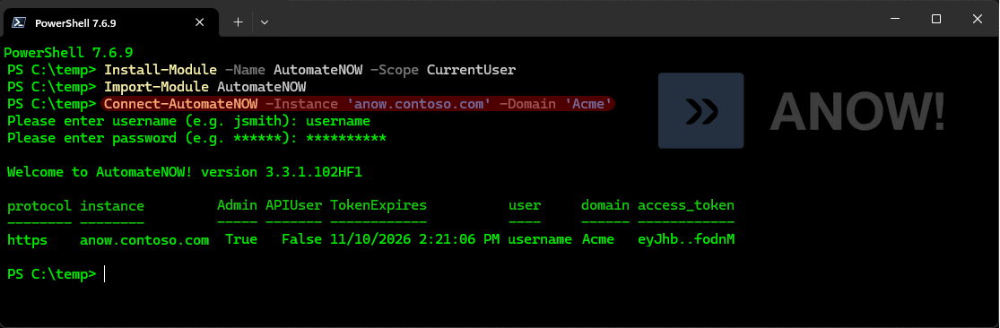

# AutomateNOW! PowerShell module

## Overview

Use PowerShell to work with the API of an AutomateNOW! instance: retrieve
objects, manage templates and resources, and automate routine administration.
Commands return typed objects and support built-in help and pipelines.

Created by AutomateNOW-Fan. This is a community-maintained module
and is not affiliated with Beta Systems.

[Getting started](#getting-started) · [Usage guide](docs/USAGE.md) ·
[FAQ](docs/FAQ.md) · [Release notes](CHANGELOG.md)

## Application compatibility

- **AutomateNOW!:** application model updated to **3.3.1.102**.
  Last validated baseline: **3.3.1.101**; v102 testing covers selected operations.
- **PowerShell:** Windows PowerShell **5.1** and PowerShell **7**.

See the [release notes](CHANGELOG.md#1047) for upgrade details.

## Before you start

- Have an AutomateNOW! account with access to the domain you want to use.
- Know your instance hostname, exact domain name and your organization's
  sign-in method.

Version **1.0.47** is available on the
[PowerShell Gallery](https://www.powershellgallery.com/packages/AutomateNOW/1.0.47).
See the [release notes](CHANGELOG.md#1047) for what's new.

## Getting started

### Install and import

Start a new PowerShell session for this walkthrough and run:

```powershell
Install-Module -Name AutomateNOW -Repository PSGallery -Scope CurrentUser
Import-Module AutomateNOW
Get-Module AutomateNOW | Select-Object Name, Version
```

[CurrentUser](https://learn.microsoft.com/en-us/powershell/module/powershellget/install-module#-scope)
installs for your account without requiring administrator rights.
The last command should show `AutomateNOW` and its loaded version. If installation
fails, retain the exact error and your PowerShell version when asking for help;
your organization's package repository or network policy may affect installation.

When using a downloaded or cloned copy instead, open PowerShell in the directory
containing the module and import its manifest:

```powershell
Import-Module .\AutomateNOW.psd1
```

Start a new PowerShell session after changing module versions so previously
loaded classes do not carry over.

### Connect

Replace both placeholders below. `-Instance` takes the hostname only, without
`https://` or `/automatenow`. Domain spelling is case-sensitive.

```powershell
Connect-AutomateNOW -Instance 'anow.example.org' -Domain 'YourDomain' -Quiet
```

This form prompts for your username and password. For browser authentication,
see [other connection methods](docs/USAGE.md#other-connection-methods).
Use this command to check the local session; a ready session returns `True`:

```powershell
Confirm-AutomateNOWSession -Quiet -DoNotRefresh
```

### Make your first read

This example requests a small page of Server Nodes and displays their IDs and
types. It does not create or modify a Server Node.

```powershell
if (-not (Confirm-AutomateNOWSession -Quiet -DoNotRefresh)) {
    throw 'No valid session. Resolve the connection message before continuing.'
}

Get-AutomateNOWServerNode -startRow 0 -endRow 5 |
    Select-Object simpleId, serverNodeType
```

Expect up to five rows. An empty result can mean there are no accessible Server
Nodes in the selected domain.



## Find the command you need

```powershell
Get-Command -Module AutomateNOW
Get-Help Get-AutomateNOWServerNode -Examples
Get-Help Connect-AutomateNOW -Full
```

For a browsable list of available commands and aliases, see the
[command catalogue](docs/COMMANDS.md).

## Highlights in 1.0.47

- View your cached permissions, including denied permissions, in a Windows window.
- Create and edit Workflow dependency conditions from PowerShell.
- Read full context-variable values or fetch previews; update values with verified results.
- Get more reliable starts, sysout downloads, queries and exports.
- Preserve omitted settings when editing templates, resources and rules.

See the [release notes](CHANGELOG.md#1047) for the full list and upgrade tips.
