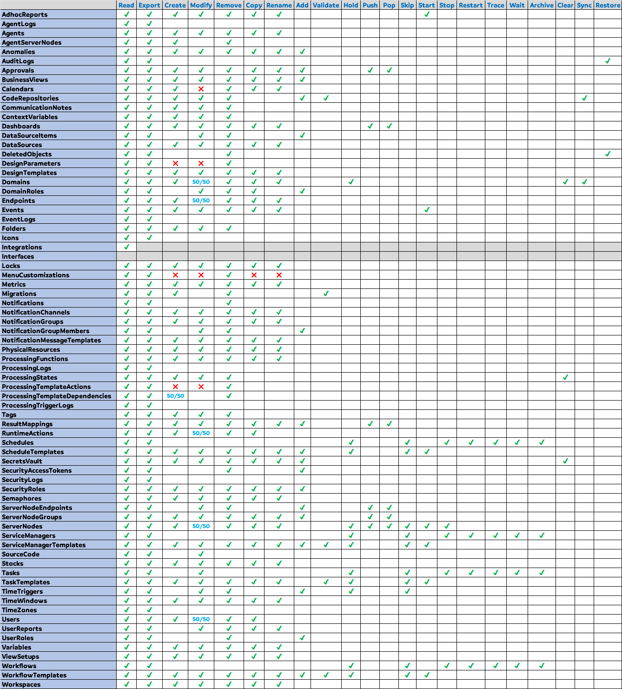

# Frequently asked questions

[Getting started](../README.md#getting-started) · [Usage and recipes](USAGE.md) ·
[Command catalogue](COMMANDS.md) · [Release notes](../CHANGELOG.md)

Quick answers for 1.0.47. Use built-in help to check parameter sets and output
types for your installed version.

### Does the module bypass server permissions?

No. ANOW still enforces account and domain permissions. A UI/API difference is
not a guarantee that an operation is available or permitted for your account.

### Can I edit ordinary dependency conditions now?

Yes. Use `Set-AutomateNOWProcessingTemplateDependency` for supported Workflow
root/item conditions. It preserves omitted settings and owner/target/group
placement, then verifies the result, including with `-Quiet`. Stock/Lock
allocation uses its own commands.

### Is this module supported by or affiliated with Beta Systems (formerly InfiniteDATA)?

No. This should be considered a community-supported tool.

### What can I do with the module?

Browse the [command catalogue](COMMANDS.md), built-in help and
[release notes](../CHANGELOG.md#1047). The chart below is a historical snapshot.

### Where are the connection details stored in my PowerShell session after successfully authenticating?

In `$global:anow_session`, which includes credentials. Keep the object private;
use `Confirm-AutomateNOWSession -Quiet -DoNotRefresh` to check readiness.

### Should I share my session object or authentication JSON when asking for help?

No. Share the command, module/PowerShell versions and reviewed diagnostic text.
Keep tokens, authentication JSON and your session object private.

### Which version of PowerShell do I need?

This module is compatible with both `Windows PowerShell 5.1` and `PowerShell Core 7.x`

### Do the functions in this module utilize the PowerShell pipeline?

Yes, except where it doesn't make sense. Otherwise, this module is designed to take advantage of the pipeline.

### I imported the AutomateNOW module into my PowerShell session. What's next?

Try `Connect-AutomateNOW -?`. Also try `Get-Command -Module AutomateNOW` to see the full list of commands.

### How can I specify the domain with the `-Domain` parameter of `Connect-AutomateNOW` if I don't know what domains are available to my account?

Supply the exact domain when you know it. If `-Domain` is omitted, the module selects the sole available domain or configured default; otherwise it reports the available choices and requires a connection request with a domain.

### How do I use a particular command? Where's the help?

Type the name of the command followed by -? for quick syntax. For the full help with examples, try `Get-Help NameOfCommand -Full`.

### Help! I keep receiving the error message "Parameter set cannot be resolved using the specified named parameters."

Type the name of the command followed by -?. You need to review the "parameter sets". Not all parameters can be mixed with others. Please consult the built-in help for that individual function.

### How do I see 👀 the actual payloads, headers, parameters that are sent to ANOW?

Use `-Verbose` for diagnostic metadata. Credentials and full request bodies are
withheld. Review output before sharing your object names or scripts.

### Why don't these functions share the identical verbs as the ANOW UI? (e.g. "Suspend" instead of "Hold")

This module uses only approved verbs. See https://learn.microsoft.com/en-us/powershell/scripting/developer/cmdlet/approved-verbs-for-windows-powershell-commands for more.

### Why do I only receive 100 results when using the Get commands? I should be getting more results...

Many collection reads default to `-startRow 0 -endRow 100`. Use the command's
paging parameters to request more; see the next answer.

### How do I paginate the results?

Use `-startRow`/`-endRow` and supported ordering; defaults vary by command.
Check for duplicate IDs and inconsistent ranges before combining pages.
See [bounded reads](USAGE.md#read-a-bounded-page). A large page alone does
not prove you have every object.

### Why can an AutomateNOW upgrade cause a class or enum error?

Results use strict classes and enums: unexpected fields or values raise an
error. Start a fresh PowerShell session, check the
[compatibility notes](../CHANGELOG.md#compatibility), and report the field/type
and versions. After a write, check its outcome before repeating it.

### How does the password encryption in this module work?

The helpers implement the ANOW-compatible credential wire format. See `Protect-AutomateNOWEncryptedString` and `Unprotect-AutomateNOWEncryptedString` help for the selected form. These helpers are not a credential vault; use SecureString inputs where the command supports them and keep decrypted values local.

### Why are some of the columns in the export .csv containing `[System.Object]`?

CSV is flat. Select scalar properties or serialize nested values before export.
For supported migration definitions, use `Export-AutomateNOWMigration` and check
its export options. A definition export is not a complete state backup.

### How do I add a Task Template to a Workflow Template?

Use `Add-AutomateNOWWorkflowTemplateItem`

### How do I change my domain?

Use `Switch-AutomateNOWDomain -Domain 'MyDomain'`

### How to retrieve a Task or Workflow (a.k.a. a "job") by its RunId?

Use `Get-AutomateNOWTask -Id 12345` for Tasks or `Get-AutomateNOWWorkflow -Id 12345` for Workflows. There is also `Get-AutomateNOWProcessingList -Id 12345` which can provide both Task and Workflow outputs.

### What are the three states involved in a Code Repository transfer?

1. The live ANOW objects.
2. ANOW's managed server-side Git checkout.
3. The external remote Git repository.

Publish commits eligible live changes into the managed checkout; Send pushes
its commits. Receive pulls remote commits into that checkout; Sync reconciles
the checkout with live objects. Sync does not perform the remote Pull. The UI
can chain steps which the module exposes separately.

### How do I send my changes to a configured remote Code Repository?

Select the intended branch, make the live-object change, Publish eligible changes
to ANOW's managed checkout, then Send its commits. See the
[outgoing repository recipe](USAGE.md#send-live-anow-changes-to-a-remote-repository).
Check each step's outcome before continuing.

### How do I apply an external remote Git change to live ANOW objects?

Select the branch, run Receive, check its result, then run Sync and verify the
intended object. See the [incoming repository recipe](USAGE.md#apply-remote-git-changes-to-live-anow-objects).
Receive alone does not apply the metadata to the live object. WhatIf suppresses
PowerShell mutation requests; it is not a server-side conflict preflight.

### Where are the 5 types of Processing Event Logs in the ANOW UI?

Use `Get-Help Read-AutomateNOWProcessingEventLog -Full` for some hints on where they all are.

### I want to set all values in my Metric to null (i.e. to reset them). How can I do this?

It's a two-step process. In any order:
1) Run `Set-AutomateNOWMetric` with the `-UnsetValue` parameter
2) Run `Set-AutomateNOWMetric` with these parameters: `-UnsetValueUnit` `-UnsetMinValue` `-UnsetVeryLowThreshold` `-UnsetLowThreshold` `-UnsetHighThreshold` `-UnsetVeryHighThreshold` `-UnsetMaxValue`

### What does Detailed add to resource reads?

Resource-specific fields such as a Calendar's calculated dates, a Lock's state
or resource history. Check the command's help for the detail fields it supports.

### How do I rearrange the sort orders of the child nodes in my load balancer node?

Refer to `Push-AutomateNOWLoadBalancerNode` and `Pop-AutomateNOWLoadBalancerNode`

### I'm confused about why some functions are prefixed with New- and others with Add-?

As a naming convention, New usually creates a standalone object, while Add often creates a child, link or item under an existing owner. The verb alone does not establish the payload or output type; check the command help.

### I'm confused about why some functions are prefixed with Get- and others with Read-?

Get usually retrieves standalone objects; Read often retrieves child or relationship records. This is a convention, not a universal type rule. The help describes the exact returned class and required owner context.

### Why is there no Copy and Rename functions for Time Triggers?

The module provides Add/Read/Remove operations for Time Triggers under a Schedule Template rather than dedicated Copy/Rename commands. Use the supported parent/trigger contract in their help; do not assume a standalone copy operation.

### How can I use `Edit-AutomateNOWDataSourceItem` if I don't already know the Id (36 character GUID) of the item?

Use the built-in help `Get-Help Edit-AutomateNOWDataSourceItem -Examples` to see examples

### Why do context variables not include Self, Parent or Root scope?

Their owner processing ID is returned, but scope is relative to the particular
run you are examining. Deriving Self/Parent/Root requires comparing that run and
its ancestors; it is not an intrinsic field on the current variable class.

### How do I read full context-variable values or edit an existing variable?

Use normal Get reads for full values and `-PreviewOnly` for lightweight lists.
Pass the typed variable to `Set-AutomateNOWContextVariable` to edit its Value;
the setter verifies the full result, including with `-Quiet`. See the
[context-variable recipe](USAGE.md#read-and-edit-context-variables).

### I'm tired of seeing the Trigger Items in the results of `Trace-AutomateNOWProcessing`

Use `-DoNotIncludeTriggers` on Trace. A supported Start command with Synchronous can return the actual run instead of a user trigger; it does not wait for completion. Capture the returned run and use a Wait command when completion matters.

### I need more from `Trace-AutomateNOWProcessing`. It only returns Workflows which were parented by my Workflow. I need to see *everything* which could have been launched by my Workflow.

Use the `-PerformDeepSearch` parameter. Note that this parameter will significantly increase the time required. Also, the UI does not offer this functionality.

### How do I start a Workflow, wait for it to finish executing and then return all of the related Context Variables in a single command?

`Get-AutomateNOWWorkflowTemplate -Id 'WorkflowTemplate1' | Start-AutomateNOWWorkflowTemplate | Trace-AutomateNOWProcessing -WaitForExecution -ReturnContextVariables`

### `Trace-AutomateNOWProcessing` doesn't seem to work. It doesn't return all of the processing items that it should be.

`Trace-AutomateNOWProcessing` does not have an `-IncludeArchived` parameter. Use `Get-Help Trace-AutomateNOWProcessing -Full` to check its supported traversal options; Get-command filters are not automatically available on Trace commands.

### How can I see the items that exist in the UI under the Monitoring -> Trigger tab?

Use `Get-AutomateNOWSchedule` to retrieve these

### What is the difference between an [ANOWResource] object, an [ANOWAnomaly] object and the [ANOWResourceAnomaly] object? This is confusing

- `ANOWResource`: the base class for resources such as Locks, Stocks and Metrics.
- `ANOWAnomaly`: an Anomaly definition used to interpret Metrics.
- `ANOWResourceAnomaly`: the link created when you add an Anomaly to a Metric.

### Why doesn't `Read-AutomateNOWSecurityAccessToken` include the actual security token?

`Read-AutomateNOWSecurityAccessToken` will tell you everything else about the security token objects except the actual token. This is by design. You only get to see the token once when it was created with `Add-AutomateNOWSecurityAccessToken`.

### Why do some functions sort descending by default and others ascending?

Defaults reflect the owning command and its API route. Read the help for its supported sort switches; not every reader exposes the same options. Always choose deliberately when paging or comparing results.

### Wait! There is `Read-AutomateNOWAgentServerNode` function but also a `Read-AutomateNOWServerNodeAgent`. Is this some kind of mistake?

They read the relationship from opposite ends:

- `Read-AutomateNOWAgentServerNode`: Server Node attachments for an Agent,
  returned as `ANOWAgentServerNode` objects.
- `Read-AutomateNOWServerNodeAgent`: Agents associated with a Server Node,
  returned as `ANOWAgent` objects.

### How can I see a list of all verbs that are represented in this module?

`Get-Command -Module AutomateNOW -CommandType Function | Select-Object -ExpandProperty Verb | Sort-Object -Unique`

### Why does an item Title filter differ from what I see in the diagram?

Name, title and processingTemplate are distinct fields. A displayed label can
fall back to the name when title is empty. Inspect the actual fields and use
the exact item GUID for an exact lookup; do not assume that a displayed label
is a stored title or that it is unique.

### How do I inspect Out Of Sync items and file-based Git merge conflicts?

Read OutOfSync and ConflictItem lists independently. They are different typed
records and must not be piped into each other's commands. Only file-conflict
records go to Compare/Merge. AcceptYours means ANOW's managed local version;
AcceptTheirs means the external remote branch version. See the
[conflict recipe](USAGE.md#inspect-repository-conflicts).

### How can I fetch only the Server Nodes that are also Load Balancers?

Use the `Get-AutomateNOWServerNode` with the `-AllLoadBalancers` switch parameter (depending on your scenario).

### Why is there no `Push-AutomateNOWCodeRepository` command?

Look for the commands using the `Send` verb instead. The `Push` and `Pop` verbs are reserved for moving objects up or down (e.g. nodes within a Load Balancer).

### How do I 'close' a Communication Note?

Use the -Close switch parameter with `Update-AutomateNOWCommunicationNote`

### How do I create a copy of a user? I was expecting `Copy-AutomateNOWSecUser` to exist.

The module has no dedicated user-copy command. `New-AutomateNOWSecUser -CopyRolesFromUser` copies roles into a new account; it does not clone every profile setting.

### Why isn't there a `Lock-AutomateNOWSecUser` to accompany `Unlock-AutomateNOWSecUser`?

The module has no companion Lock command. Use `Enable-AutomateNOWSecUser` or `Disable-AutomateNOWSecUser` for supported account enable/disable operations; that is distinct from clearing an existing lock with Unlock.

### Where is the function for exporting items from within a Code Repository?

Use `Export-AutomateNOWCodeRepositoryObjectSource`

### Why can't I combine the `-Id` parameter with the `-IncludeArchived` parameter when using the `Get-AutomateNOWTask` (et al) functions?

The processing archive is already included when using the `-Id` parameter

### Why is the 'secRole' property sometimes empty on users?

Not all users have 'internal' security roles. The 'secRole' property is a string representing the Id of the internal security role for that user

### How do I export repository objects through Migration Export?

For one repository, read its CodeRepositoryItem records, convert them with
`ConvertFrom-AutomateNOWCodeRepositoryItem`, then pass the resulting objects
to `Export-AutomateNOWMigration` using the required export options. Establish
complete bounded membership first; a single large page is not a completeness
guarantee. Check both commands' examples before combining multiple repositories.

### As a non-admin on the instance, how can I generate a full report of all of my permissions (granted or not) (including undocumented) for all domains?

For a Windows window of supported permissions, run
`Show-AutomateNOWSecUserPermission` in your existing non-admin session. It uses
cached roles and includes denied permissions. Reconnect normally when you need
updated roles. For the text report, including undocumented permissions, use:

`Measure-AutomateNOWSecUserPermission -Me -IncludeUndocumented -FullReport | Resolve-AutomateNOWSecUserPermission`

Note that the `-FullReport` parameter will include all privileges whether granted or not

### How can I export the permission report from the previous question to a .csv?

`Measure-AutomateNOWSecUserPermission -Me | Export-AutomateNOWSecUserPermission`

### What if I am an admin and I wish to do the same for a different non-admin user?

`Get-AutomateNOWSecUser -Id 'User1' | Measure-AutomateNOWSecUserPermission | Export-AutomateNOWSecUserPermission`
